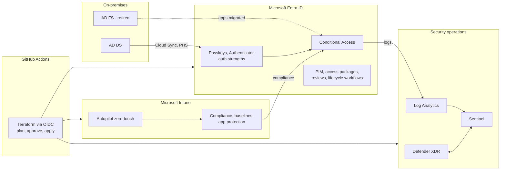

# Microsoft Entra Zero Trust Platform

Microsoft Entra ID as the identity and access plane, Microsoft Intune as the endpoint plane, Microsoft Sentinel with Defender XDR for security operations, and a guided migration from AD DS and AD FS. Built in Terraform, aligned to the Microsoft Cybersecurity Reference Architectures and the Zero Trust deployment guides, and deployed end to end by GitHub Actions with no stored secrets.

[](https://github.com/Mpurushotham/microsoft-entra-zero-trust-platform/actions/workflows/ci-quality.yml)
[](https://github.com/Mpurushotham/microsoft-entra-zero-trust-platform/actions/workflows/drift-detection.yml)
[](https://github.com/Mpurushotham/microsoft-entra-zero-trust-platform/actions/workflows/end-to-end-deploy.yml)

| Stack | Workflow |
|---|---|
| `00-bootstrap` | [](https://github.com/Mpurushotham/microsoft-entra-zero-trust-platform/actions/workflows/00-bootstrap.yml) |
| `10-entra-foundation` | [](https://github.com/Mpurushotham/microsoft-entra-zero-trust-platform/actions/workflows/10-entra-foundation.yml) |
| `20-entra-conditional-access` | [](https://github.com/Mpurushotham/microsoft-entra-zero-trust-platform/actions/workflows/20-entra-conditional-access.yml) |
| `30-entra-governance` | [](https://github.com/Mpurushotham/microsoft-entra-zero-trust-platform/actions/workflows/30-entra-governance.yml) |
| `40-hybrid-migration` | [](https://github.com/Mpurushotham/microsoft-entra-zero-trust-platform/actions/workflows/40-hybrid-migration.yml) |
| `50-intune-foundation` | [](https://github.com/Mpurushotham/microsoft-entra-zero-trust-platform/actions/workflows/50-intune-foundation.yml) |
| `60-intune-autopilot-zero-touch` | [](https://github.com/Mpurushotham/microsoft-entra-zero-trust-platform/actions/workflows/60-intune-autopilot.yml) |
| `70-security-operations` | [](https://github.com/Mpurushotham/microsoft-entra-zero-trust-platform/actions/workflows/70-security-operations.yml) |

## Architecture



More diagrams, including the MCRA mapping, Conditional Access decision flow, PIM activation, migration waves and the Autopilot sequence, are in the [architecture documentation](docs/architecture/README.md).

## Repository layout

```text
.
├── .github/workflows/          # one workflow per stack, end-to-end, quality, drift
├── docs/                       # GitBook documentation (root defined in .gitbook.yaml)
├── scripts/
│   ├── bootstrap/              # one-time state and OIDC bootstrap
│   ├── hybrid-migration/       # AD DS and AD FS assessment, cutover, rollback
│   └── intune/                 # Autopilot hardware hash collection and upload
├── terraform/
│   ├── modules/                # reusable modules (entra-*, intune-*, hybrid-*, secops-*, bootstrap-*)
│   └── stacks/
│       ├── 00-bootstrap/
│       ├── 10-entra-foundation/
│       ├── 20-entra-conditional-access/
│       ├── 30-entra-governance/
│       ├── 40-hybrid-migration/
│       ├── 50-intune-foundation/
│       ├── 60-intune-autopilot-zero-touch/
│       └── 70-security-operations/
├── .gitbook.yaml
├── .pre-commit-config.yaml
├── .tflint.hcl
├── CONTRIBUTING.md
├── SECURITY.md
└── LICENSE
```

## Quick start

1. **Check prerequisites.** Microsoft Entra ID P1 or P2, Intune Plan 1 (Microsoft 365 E3 or E5), an Azure subscription, and an operator who can grant admin consent. See [Prerequisites](docs/getting-started/prerequisites.md).
2. **Bootstrap once.** Run `scripts/bootstrap/Initialize-Bootstrap.ps1 -WhatIf`, then without `-WhatIf` and with `-ConfigureGitHub`. It creates the state storage account, the per-environment plan and apply identities with federated credentials, and the GitHub environments, secrets and variables. See [Bootstrap](docs/getting-started/bootstrap.md).
3. **Confirm GitHub configuration.**

   | Name | Kind |
   |---|---|
   | `AZURE_CLIENT_ID` | Environment secret in `dev` and `prod` (apply identity) |
   | `AZURE_PLAN_CLIENT_ID_DEV`, `AZURE_PLAN_CLIENT_ID_PROD` | Repository secrets (plan identities) |
   | `AZURE_TENANT_ID`, `AZURE_SUBSCRIPTION_ID` | Repository secrets |
   | `TFSTATE_RG`, `TFSTATE_SA` | Repository variables |

4. **Deploy to dev.**

   ```bash
   gh workflow run end-to-end-deploy.yml -f environment=dev -f action=apply
   ```

5. **Review, then promote.** Conditional Access ships in report-only. Promote policies with evidence using the [promotion runbook](docs/operations/ca-promotion.md), then deploy to `prod` with reviewer approval.

## Documentation

The full documentation is published from [`docs/`](docs/README.md) in GitBook format: architecture, identity, migration, endpoint, security operations, deployment, operations runbooks, and reference material including the licensing matrix, Graph permissions per stack and architecture decision records.

## Contributing and security

See [CONTRIBUTING.md](CONTRIBUTING.md) and [SECURITY.md](SECURITY.md).

## License

[MIT](LICENSE) © 2026 Purushotham Muktha
