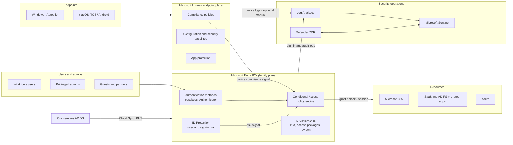

# Microsoft Entra Zero Trust Platform

This platform makes Microsoft Entra ID the identity and access plane for the organisation, Microsoft Intune the endpoint management plane, and Microsoft Sentinel with Defender XDR the security operations plane. Everything is deployed as Terraform through topic-wise GitHub Actions workflows, following Microsoft's published deployment plans.


**Who this is for.** Identity architects, endpoint engineers and security operations teams who want a repeatable, reviewable and auditable way to stand up a Zero Trust tenant, or to move an existing Active Directory estate to cloud authentication.


## What you get

| Capability | Delivered by | Microsoft guidance it follows |
|---|---|---|
| Tenant baseline, break-glass, authentication methods | `10-entra-foundation` | Entra ID deployment plans, emergency access accounts |
| Conditional Access baseline | `20-entra-conditional-access` | Conditional Access deployment plan and policy templates |
| PIM, entitlement management, access reviews, lifecycle workflows | `30-entra-governance` | Microsoft Entra ID Governance deployment guides |
| AD DS to Entra migration | `40-hybrid-migration` | Migrate from federation to cloud authentication, staged rollout, AD FS app migration |
| Intune baseline | `50-intune-foundation` | Intune deployment guide, security baselines, app protection framework |
| Zero-touch provisioning | `60-intune-autopilot-zero-touch` | Windows Autopilot and Autopilot device preparation |
| Security operations | `70-security-operations` | Microsoft Sentinel, Defender XDR, Entra security operations guide |

## Platform at a glance

## How the documentation is organised



1. Read [Prerequisites and licensing](getting-started/prerequisites.md).
2. Run the one-time [bootstrap](getting-started/bootstrap.md).
3. Execute the [first end-to-end deployment](getting-started/first-deployment.md) against `dev`.



* [Architecture overview](architecture/README.md) and [MCRA mapping](architecture/mcra-mapping.md)
* [Zero Trust pillars](architecture/zero-trust-pillars.md)
* [Architecture decision records](architecture/adr/README.md)



* [Break-glass accounts](operations/break-glass.md)
* [Conditional Access promotion](operations/ca-promotion.md)
* [Drift response](operations/drift-response.md)
* [Rollback per stack](operations/rollback-per-stack.md)



* [AD DS to Entra migration](migration/README.md)
* [Assessment and readiness](migration/assessment.md)
* [Cutover runbooks](migration/cutover-runbooks.md)
* [Migration rollback](migration/rollback.md)



## Design principles

* **Microsoft method first.** Every control maps to a Microsoft Learn deployment plan or template. Deviations are recorded as [ADRs](architecture/adr/README.md).
* **Report-only before enforce.** Conditional Access policies ship as `enabledForReportingButNotEnforced` and are promoted deliberately. See [ADR-0003](architecture/adr/0003-conditional-access-report-only-first.md).
* **No standing secrets.** CI authenticates with OpenID Connect workload identity federation. See [ADR-0004](architecture/adr/0004-oidc-workload-identity-federation.md).
* **Break-glass is sacred.** Two cloud-only emergency access accounts are excluded from every policy and tested monthly.
* **Small blast radius.** Eight independent stacks with their own state and their own workflow.

## References

* [Microsoft Cybersecurity Reference Architectures (MCRA)](https://learn.microsoft.com/en-us/security/adoption/mcra)
* [Zero Trust deployment plan overview](https://learn.microsoft.com/en-us/security/zero-trust/deploy/overview)
* [Microsoft Entra deployment plans](https://learn.microsoft.com/en-us/entra/architecture/deployment-plans)
* [Intune planning guide](https://learn.microsoft.com/en-us/intune/fundamentals/planning-guide)
