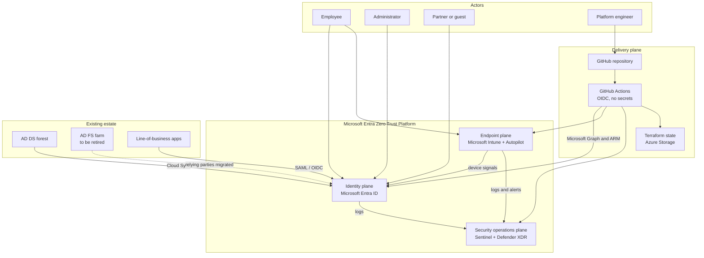

# Architecture overview

The platform implements the identity, endpoint and security operations capabilities of the Microsoft Cybersecurity Reference Architectures (MCRA). Microsoft Entra ID is the control plane for every access decision, Intune supplies device health, and Microsoft Sentinel with Defender XDR closes the loop with detection and response.

## System context

## Capability layers

| Layer | Capabilities | Stacks |
|---|---|---|
| Identity foundation | Break-glass, groups, administrative units, named locations, authentication methods and strengths, custom security attributes | `10-entra-foundation` |
| Access policy | Conditional Access baseline per persona, session controls, token protection | `20-entra-conditional-access` |
| Governance | PIM for roles and groups, access packages, access reviews, lifecycle workflows | `30-entra-governance` |
| Hybrid | Cloud Sync, password hash sync, staged rollout, AD FS application migration, device migration | `40-hybrid-migration` |
| Endpoint | Compliance, configuration, security baselines, endpoint security, app protection | `50-intune-foundation` |
| Provisioning | Autopilot profiles, device preparation, Enrollment Status Page, Apple ADE and Android Enterprise notes | `60-intune-autopilot-zero-touch` |
| Security operations | Log Analytics, Sentinel, connectors, analytics rules | `70-security-operations` |
| Delivery | State backend, OIDC deployment identity | `00-bootstrap` |

## Architecture pages

* [MCRA mapping](mcra-mapping.md)
* [Zero Trust pillars](zero-trust-pillars.md)
* [Identity architecture](identity-architecture.md)
* [Endpoint architecture](endpoint-architecture.md)
* [Hybrid identity architecture](hybrid-architecture.md)
* [Security operations architecture](security-operations-architecture.md)
* [Network and data flows](network-and-data-flows.md)
* [Architecture decision records](adr/README.md)

## References

* [Microsoft Cybersecurity Reference Architectures (MCRA)](https://learn.microsoft.com/en-us/security/adoption/mcra)
* [Zero Trust overview](https://learn.microsoft.com/en-us/security/zero-trust/zero-trust-overview)
* [Microsoft Entra deployment plans](https://learn.microsoft.com/en-us/entra/architecture/deployment-plans)
