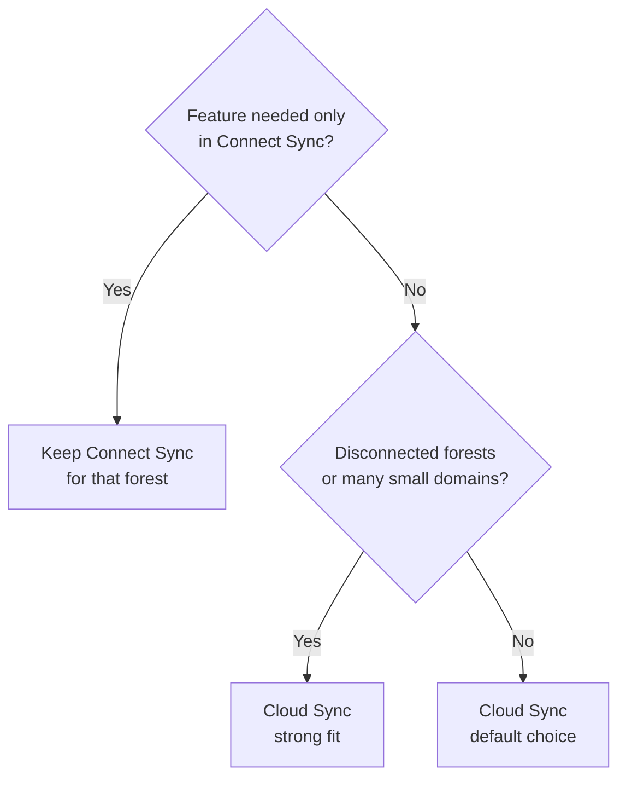

# ADR-0002 Entra Cloud Sync over Entra Connect Sync

* Status: Accepted
* Date: 2026-11-01
* Deciders: Identity architecture

## Context

Users and groups originate in AD DS and must be synchronised to Microsoft Entra ID. Microsoft offers two engines: **Entra Connect Sync**, a server-installed synchronisation engine with a local SQL database, and **Entra Cloud Sync**, lightweight provisioning agents whose configuration lives in the cloud.

## Decision

Use **Entra Cloud Sync** with password hash synchronisation for every forest whose requirements it meets. Retain Entra Connect Sync only where a documented blocker exists (for example device writeback or other features Cloud Sync does not support at the time of assessment), and re-assess these blockers at every migration wave.

## Consequences

* Agents are installed on at least three servers per forest for high availability; no SQL Server, no staging server.
* Configuration is in the cloud and can be inspected through Microsoft Graph.
* Cloud Sync group writeback supports writing cloud security groups back to AD DS for on-premises apps.
* The assessment script in `scripts/hybrid-migration/` reports features in use on the existing Connect Sync server to confirm no blocker exists.

## Alternatives considered

| Option | Why not chosen |
|---|---|
| Keep Entra Connect Sync everywhere | More infrastructure to patch and protect as tier-0; no benefit for the target scenario |
| Both engines on the same objects | Unsupported when scoped to the same objects |

## References

* [What is Microsoft Entra Cloud Sync](https://learn.microsoft.com/en-us/entra/identity/hybrid/cloud-sync/what-is-cloud-sync)
* [Cloud Sync prerequisites](https://learn.microsoft.com/en-us/entra/identity/hybrid/cloud-sync/how-to-prerequisites)
* [Hybrid identity installation options](https://learn.microsoft.com/en-us/entra/identity/hybrid/install)
* [Group writeback with Cloud Sync](https://learn.microsoft.com/en-us/entra/identity/hybrid/group-writeback-cloud-sync)
