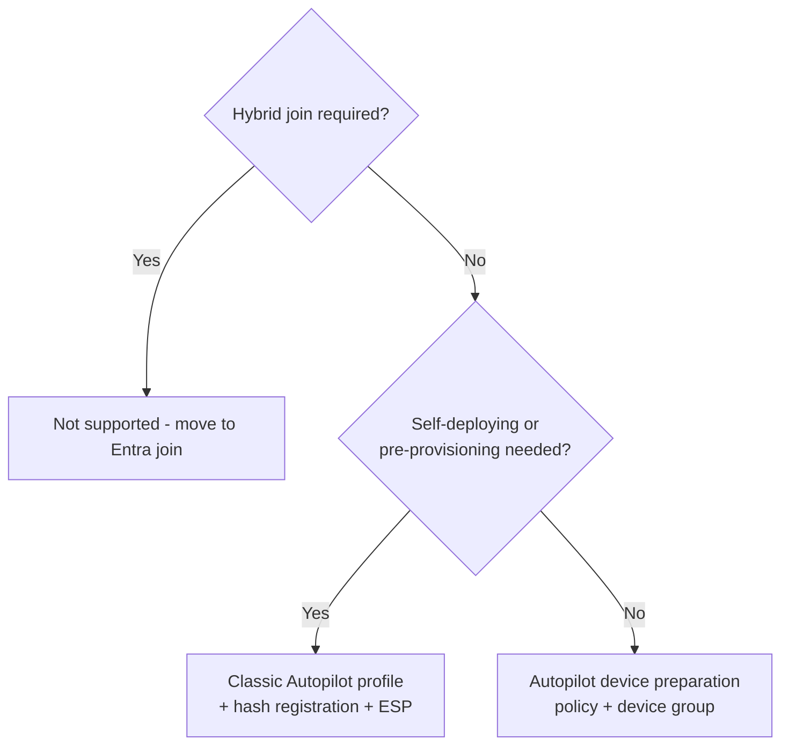

# ADR-0005 Autopilot device preparation as the default Windows provisioning path

* Status: Accepted
* Date: 2026-11-01
* Deciders: Endpoint architecture

## Context

Windows Autopilot has two generations. **Classic Windows Autopilot** depends on hardware hash registration before the device reaches the user and supports user-driven, self-deploying and pre-provisioning modes with the Enrollment Status Page. **Windows Autopilot device preparation** needs no hash registration, uses a device security group populated at enrolment, and reports deployment status in near real time. It supports Entra join only.

## Decision

* Use **Autopilot device preparation** as the default for new, user-driven Entra-joined Windows devices.
* Keep **classic Autopilot** profiles for scenarios device preparation does not cover: self-deploying kiosks, pre-provisioning (white glove) by a partner, and devices where hash registration by the OEM or reseller is already contractual.
* `60-intune-autopilot-zero-touch` defines the classic profiles and their groups, plus the device preparation group `zt-<env>-devices-autopilot-device-preparation`. The device preparation policy itself is created in the Intune admin center, because Microsoft Graph does not yet publish its schema.

## Consequences

* No dependency on OEMs uploading hashes for the standard user-driven path.
* Two sets of policies to maintain; the decision is revisited when device preparation reaches feature parity.
* Hybrid Entra join through Autopilot is not offered; new devices are Entra joined, in line with Microsoft's recommendation.

## References

* [Windows Autopilot overview](https://learn.microsoft.com/en-us/autopilot/overview)
* [Windows Autopilot device preparation overview](https://learn.microsoft.com/en-us/autopilot/device-preparation/overview)
* [Compare Autopilot device preparation and Windows Autopilot](https://learn.microsoft.com/en-us/autopilot/device-preparation/compare)
* [Autopilot self-deploying mode](https://learn.microsoft.com/en-us/autopilot/self-deploying)
* [Autopilot pre-provisioning](https://learn.microsoft.com/en-us/autopilot/pre-provision)
