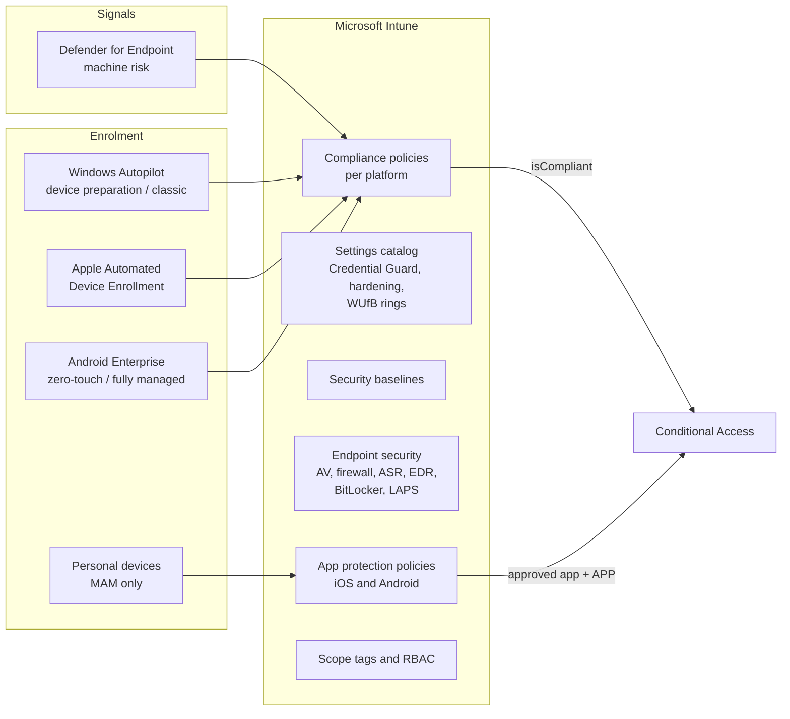
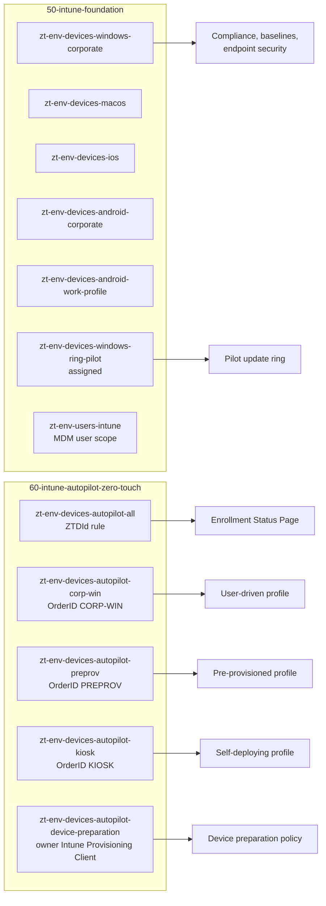

# Endpoint architecture

Intune is the single management authority for corporate devices. Device health becomes an access signal through compliance, which Conditional Access consumes. New Windows devices are provisioned with Windows Autopilot and never touched by IT.

## Endpoint management planes

## Policy layering

| Layer | Windows | macOS | iOS / iPadOS | Android Enterprise |
|---|---|---|---|---|
| Enrolment | Autopilot, Entra join | ADE | ADE | Zero-touch, fully managed, work profile |
| Compliance | BitLocker, Secure Boot, TPM, OS version, Defender, machine risk | FileVault, OS version, firewall | Jailbreak, OS version, passcode | Play Integrity, OS version, passcode |
| Configuration | Settings catalog (Credential Guard, OS hardening), Update rings and feature updates | Settings catalog | Device restrictions | Device restrictions |
| Security baseline | Microsoft Security Baseline for Windows, assigned in the portal | Not applicable | Not applicable | Not applicable |
| Endpoint security | Antivirus, firewall, ASR, EDR onboarding | Antivirus, EDR | Not applicable | Not applicable |
| App protection | Not applicable | Not applicable | Data protection framework level 2 or 3 | Data protection framework level 2 or 3 |


Security baselines and settings catalog profiles can overlap. The Microsoft baseline is assigned from the portal. The Terraform settings catalog profiles cover only settings the baseline leaves unset, which avoids the conflicts Intune reports as errors.


## Assignment model

Policies target Entra groups, never individual users. Intune device groups are owned by the endpoint stacks only: `50-intune-foundation` creates the platform and ring groups, and `60-intune-autopilot-zero-touch` creates the Autopilot groups. `10-entra-foundation` creates no device groups.

| Group | Owner | Membership |
|---|---|---|
| `zt-<env>-devices-{windows-corporate,macos,ios,android-corporate,android-work-profile}` | 50 | Dynamic, by platform and ownership |
| `zt-<env>-devices-windows-ring-pilot` | 50 | Assigned pilot devices for the pilot update ring |
| `zt-<env>-users-intune` | 50 | Users in MDM scope |
| `zt-<env>-intune-role-{helpdesk,endpoint-security,policy-profile,read-only}` | 50 | Intune RBAC role groups |
| `zt-<env>-devices-autopilot-all` | 60 | Dynamic, every device with a `ZTDId` |
| `zt-<env>-devices-autopilot-{corp-win,preprov,kiosk}` | 60 | Dynamic, by Autopilot group tag (`[OrderID]:<TAG>`) |
| `zt-<env>-devices-autopilot-device-preparation` | 60 | Added during OOBE by the Intune Provisioning Client |

## References

* [Secure endpoints with Zero Trust](https://learn.microsoft.com/en-us/security/zero-trust/deploy/endpoints)
* [Intune planning guide](https://learn.microsoft.com/en-us/intune/fundamentals/planning-guide)
* [Intune deployment guide](https://learn.microsoft.com/en-us/intune/fundamentals/setup-migration)
* [Security baselines in Intune](https://learn.microsoft.com/en-us/intune/device-security/security-baselines/overview)
* [Endpoint security policies](https://learn.microsoft.com/en-us/intune/device-security/endpoint-security-policies)
* [App protection data protection framework](https://learn.microsoft.com/en-us/intune/app-management/protection/data-protection-framework)
* [Windows Autopilot overview](https://learn.microsoft.com/en-us/autopilot/overview)
