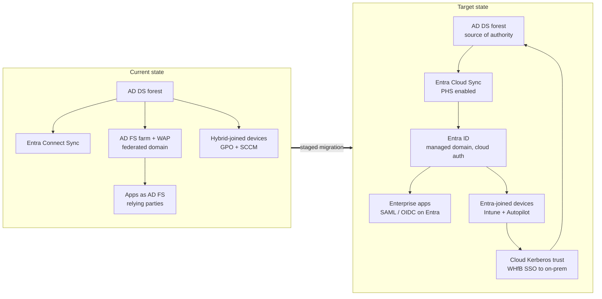

# Hybrid identity architecture

Most organisations start with an Active Directory Domain Services forest, AD FS for federation and hybrid-joined devices. The target state removes AD FS, moves authentication to Microsoft Entra ID, and makes new devices Entra joined. AD DS remains the source of authority for users during the transition.

## Current state to target state

## Component decisions

| Component | Current | Target | Decision record |
|---|---|---|---|
| Synchronisation | Entra Connect Sync | Entra Cloud Sync where supported; Connect Sync retained only for unsupported scenarios | [ADR-0002](adr/0002-cloud-sync-over-connect-sync.md) |
| Authentication | Federated through AD FS | Password hash sync with cloud authentication | Microsoft recommended method |
| Seamless SSO | Desktop SSO through AD FS | Primary Refresh Token on Entra-joined devices; Seamless SSO only for remaining domain-joined devices | Retire Seamless SSO when no hybrid devices remain |
| On-premises resource access | Kerberos from domain-joined devices | Windows Hello for Business cloud Kerberos trust | No PKI dependency |
| Applications | AD FS relying parties | Entra enterprise applications | Migrated per wave |
| Devices | Hybrid Entra join | Entra join through Autopilot at refresh | Device refresh cycle |
| Groups | AD DS groups | Cloud groups, written back to AD DS where on-premises apps need them | Cloud Sync group writeback |

## Why password hash sync

Microsoft recommends password hash synchronisation as the primary or backup authentication method because it removes the on-premises dependency during sign-in, enables leaked credential detection in ID Protection, and keeps users signing in if the on-premises environment is unavailable. Pass-through authentication is not used.


AD DS stays authoritative for user attributes until the organisation completes a separate source-of-authority switch. The platform migrates **authentication** and **applications**, not the HR-to-directory provisioning flow.


## References

* [What is hybrid identity](https://learn.microsoft.com/en-us/entra/identity/hybrid/whatis-hybrid-identity)
* [What is Microsoft Entra Cloud Sync](https://learn.microsoft.com/en-us/entra/identity/hybrid/cloud-sync/what-is-cloud-sync)
* [Password hash synchronization](https://learn.microsoft.com/en-us/entra/identity/hybrid/connect/whatis-phs)
* [Migrate from federation to cloud authentication](https://learn.microsoft.com/en-us/entra/identity/hybrid/connect/migrate-from-federation-to-cloud-authentication)
* [Windows Hello for Business cloud Kerberos trust](https://learn.microsoft.com/en-us/windows/security/identity-protection/hello-for-business/deploy/hybrid-cloud-kerberos-trust)
* [Group writeback with Cloud Sync](https://learn.microsoft.com/en-us/entra/identity/hybrid/group-writeback-cloud-sync)
* [Plan your Microsoft Entra join deployment](https://learn.microsoft.com/en-us/entra/identity/devices/device-join-plan)
