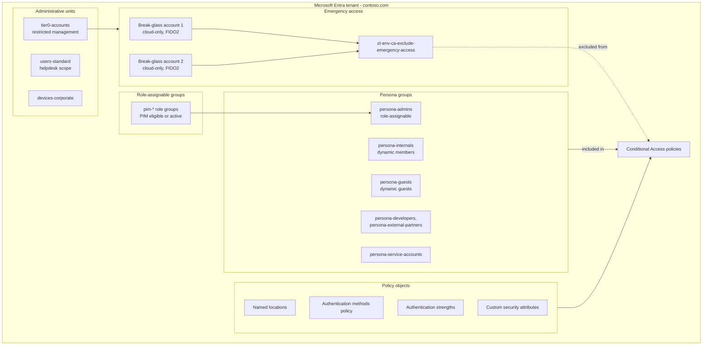

# Identity architecture

A single Microsoft Entra tenant is the identity provider for the workforce, administrators, guests and workload identities. The logical design below governs how objects are named, grouped, delegated and protected.

## Tenant logical design

## Naming convention

All objects created by the platform follow `<name_prefix>-<environment>-<purpose>`, with `name_prefix` defaulting to `zt` and `environment` being `dev` or `prod`.

| Object | Pattern | Example |
|---|---|---|
| Security group | `zt-<env>-<persona or purpose>` | `zt-prod-persona-admins` |
| CA exclusion group | `zt-<env>-ca-exclude-<reason>` | `zt-prod-ca-exclude-emergency-access` |
| Staged rollout wave group | `zt-<env>-hybrid-wave-<wave>` | `zt-prod-hybrid-wave-pilot` |
| Intune device group (stack 50) | `zt-<env>-devices-<platform>` | `zt-prod-devices-windows-corporate` |
| Autopilot device group (stack 60) | `zt-<env>-devices-autopilot-<tag>` | `zt-prod-devices-autopilot-corp-win` |
| PIM role group | `zt-<env>-pim-<role>` | `zt-prod-pim-global-administrators` |
| Administrative unit | `zt-<env>-<scope>` | `zt-prod-tier0-accounts` |
| Named location | `zt-<env>-nl-<purpose>` | `zt-prod-nl-blocked-countries` |
| Authentication strength | `zt-<env>-as-<purpose>` | `zt-prod-as-phishing-resistant-admins` |
| Conditional Access policy | `<prefix>-<env>-CA<nnn>-<Persona>-<Purpose>-<Apps>-<Platform>-<Control>` | `zt-prod-CA000-Global-BaseProtection-AllApps-AnyPlatform-Block-LegacyAuthentication` |


Identity objects (persona, PIM, governance and CA exclusion groups, administrative units, named locations, strengths) belong to `10-entra-foundation`. Intune device groups belong to `50-intune-foundation` and `60-intune-autopilot-zero-touch` only. Each stack's outputs list the exact names.


## Authentication design

| Method | State | Rationale |
|---|---|---|
| Passkeys (FIDO2), including device-bound passkeys in Microsoft Authenticator | Enabled for all users | Phishing-resistant; required for admins |
| Microsoft Authenticator push with number matching | Enabled for all users | Default MFA for the workforce |
| Temporary Access Pass | Enabled for onboarding groups | Bootstraps passwordless registration and Autopilot |
| Windows Hello for Business | Enabled through Intune | Phishing-resistant on managed Windows |
| SMS and voice call | Disabled | Weak against SIM swap and social engineering |
| Email OTP | Guests only | B2B collaboration fallback |

Conditional Access uses the built-in **Multifactor authentication** strength plus three custom strengths created by `10-entra-foundation`: `as-phishing-resistant-admins` (CA100), `as-passwordless-mfa` and `as-security-info-registration` (CA004).

## Delegation model

* Tier-0 roles (Global Administrator, Privileged Role Administrator, Privileged Authentication Administrator) are PIM-eligible only, with approval. See [Privileged Identity Management](../identity/pim.md) for the full tier model.
* Helpdesk Administrator is scoped to the `users-standard` administrative unit for `pim-helpdesk-administrators`.
* Break-glass and tier-0 accounts sit in the `tier0-accounts` administrative unit so only privileged administrators can modify them.

## References

* [Microsoft Entra deployment plans](https://learn.microsoft.com/en-us/entra/architecture/deployment-plans)
* [Manage emergency access accounts](https://learn.microsoft.com/en-us/entra/identity/role-based-access-control/security-emergency-access)
* [Administrative units](https://learn.microsoft.com/en-us/entra/identity/role-based-access-control/administrative-units)
* [Manage authentication methods](https://learn.microsoft.com/en-us/entra/identity/authentication/concept-authentication-methods-manage)
* [Authentication strengths](https://learn.microsoft.com/en-us/entra/identity/authentication/concept-authentication-strengths)
* [Custom security attributes](https://learn.microsoft.com/en-us/entra/fundamentals/custom-security-attributes-overview)
