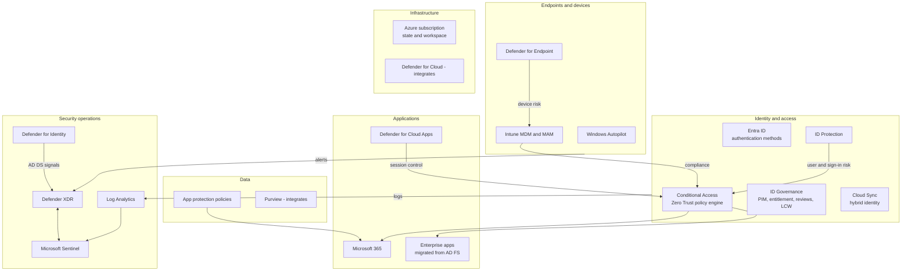

# MCRA mapping

The Microsoft Cybersecurity Reference Architectures describe how Microsoft security capabilities fit together across identity, devices, applications, data, infrastructure and security operations. This page shows which parts of the MCRA the platform implements, which it integrates with, and which are out of scope.

## MCRA-aligned architecture

## Coverage

| MCRA area | Capability | Status | Where |
|---|---|---|---|
| Identity and access | Microsoft Entra ID, passwordless authentication | Implemented | `10-entra-foundation` |
| Identity and access | Conditional Access | Implemented | `20-entra-conditional-access` |
| Identity and access | Privileged Identity Management, entitlement management, access reviews | Implemented | `30-entra-governance` |
| Identity and access | Hybrid identity, cloud authentication | Implemented | `40-hybrid-migration` |
| Identity and access | Microsoft Entra ID Protection | Consumed through risk-based policies | `20-entra-conditional-access` |
| Endpoints | Intune, security baselines, endpoint security | Implemented | `50-intune-foundation` |
| Endpoints | Windows Autopilot | Implemented | `60-intune-autopilot-zero-touch` |
| Endpoints | Defender for Endpoint onboarding | Implemented through EDR policy | `50-intune-foundation` |
| Applications | Enterprise application SSO | Implemented for migrated AD FS apps | `40-hybrid-migration` |
| Applications | Defender for Cloud Apps | Integration notes | [Security operations](../security-operations/README.md) |
| Data | App protection (MAM) | Implemented | `50-intune-foundation` |
| Data | Microsoft Purview | Out of scope | Not deployed |
| Infrastructure | Defender for Cloud | Out of scope | Not deployed |
| Security operations | Microsoft Sentinel, Defender XDR connector | Implemented | `70-security-operations` |
| Security operations | Defender for Identity | Integration notes | [Security operations](../security-operations/README.md) |


"Integration notes" means the platform configures the Entra or Sentinel side and documents the product-side steps, because the product exposes no stable Terraform or Graph surface for the remainder.


## References

* [Microsoft Cybersecurity Reference Architectures (MCRA)](https://learn.microsoft.com/en-us/security/adoption/mcra)
* [Zero Trust adoption framework](https://learn.microsoft.com/en-us/security/zero-trust/adopt/zero-trust-adoption-overview)
* [Microsoft Defender XDR](https://learn.microsoft.com/en-us/defender-xdr/microsoft-365-defender)
* [Microsoft Defender for Identity](https://learn.microsoft.com/en-us/defender-for-identity/what-is)
* [Microsoft Defender for Cloud Apps](https://learn.microsoft.com/en-us/defender-cloud-apps/what-is-defender-for-cloud-apps)
