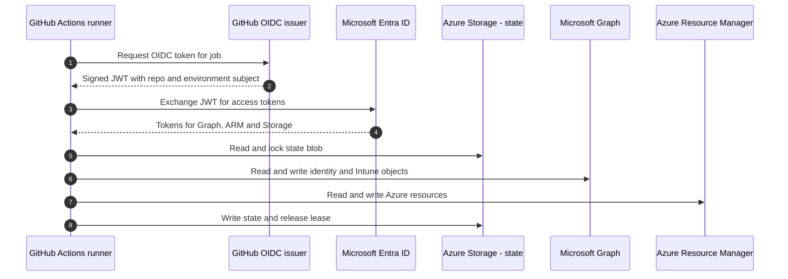

# Network and data flows

The platform has no network perimeter of its own. Every flow is an authenticated call to a Microsoft cloud endpoint over TLS. This page lists the flows so that firewall, proxy and data protection reviews have a single source.

## Deployment-time flows

## Run-time flows

| From | To | Protocol | Purpose |
|---|---|---|---|
| User device | `login.microsoftonline.com` | HTTPS | Authentication and token issuance |
| Entra-joined Windows | Intune service endpoints | HTTPS | MDM check-in, policy, compliance |
| Autopilot device | Autopilot and Windows Update endpoints | HTTPS | Profile download, OOBE, ESP |
| Cloud Sync provisioning agent | Entra ID provisioning service | HTTPS outbound only | Directory synchronisation and password hash sync |
| Entra-joined Windows with cloud Kerberos trust | On-premises domain controllers | Kerberos | Access to file shares and on-premises apps |
| Entra ID | Log Analytics workspace | Azure backbone | Diagnostic log export |
| Defender for Identity sensor | Defender for Identity cloud service | HTTPS outbound only | AD DS signal collection |


The Cloud Sync agent and Defender for Identity sensor need **outbound** HTTPS only. No inbound ports are opened. Retiring AD FS removes the last inbound published endpoint, the Web Application Proxy.


## Data residency and classification

| Data | Location | Classification | Protection |
|---|---|---|---|
| Terraform state | Azure Storage in the chosen region | Confidential: object IDs, policy definitions | Entra-only access, versioning, private access |
| Identity logs | Log Analytics workspace | Confidential: personal data | Workspace RBAC, retention per policy |
| Autopilot hardware hashes | Transient CSV during import | Internal | Uploaded through Graph, never committed |
| Plans | GitHub Actions artifacts | Confidential | Short retention, repository access only |


Plan artifacts can reveal user principal names and group memberships. Keep the repository private, and keep artifact retention short.


## References

* [Secure networks with Zero Trust](https://learn.microsoft.com/en-us/security/zero-trust/deploy/networks)
* [Secure data with Zero Trust](https://learn.microsoft.com/en-us/security/zero-trust/deploy/data)
* [Microsoft Entra Cloud Sync prerequisites](https://learn.microsoft.com/en-us/entra/identity/hybrid/cloud-sync/how-to-prerequisites)
* [Windows Autopilot requirements](https://learn.microsoft.com/en-us/autopilot/requirements)
* [Log Analytics workspace overview](https://learn.microsoft.com/en-us/azure/azure-monitor/logs/log-analytics-workspace-overview)
