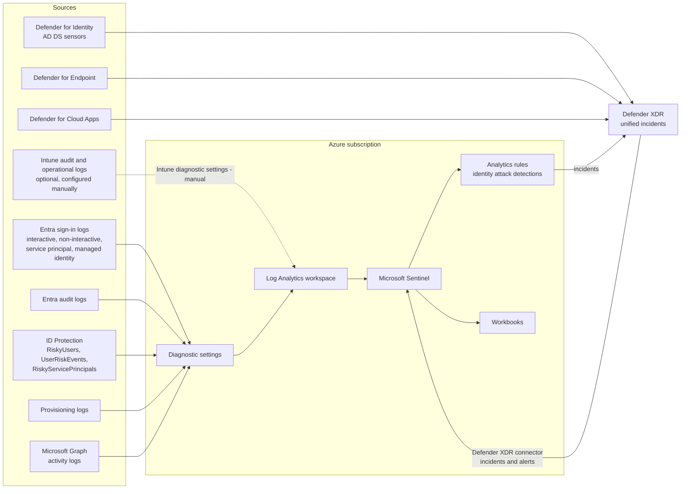

# Security operations architecture

Identity is the most attacked surface in a cloud-first estate. The security operations plane collects identity, device and application telemetry into one Log Analytics workspace, runs Microsoft Sentinel analytics over it, and correlates incidents with Defender XDR in the unified security operations platform.

## Data flow

## Log categories collected

| Category | Table | Licence needed |
|---|---|---|
| Sign-in logs | `SigninLogs` | P1 |
| Non-interactive user sign-ins | `AADNonInteractiveUserSignInLogs` | P1 |
| Service principal sign-ins | `AADServicePrincipalSignInLogs` | P1 |
| Managed identity sign-ins | `AADManagedIdentitySignInLogs` | P1 |
| Audit logs | `AuditLogs` | Free |
| Provisioning logs | `AADProvisioningLogs` | P1 |
| Risky users, risk events | `AADRiskyUsers`, `AADUserRiskEvents` | P2 |
| Risky service principals | `AADRiskyServicePrincipals`, `AADServicePrincipalRiskEvents` | Workload Identities Premium |
| Microsoft Graph activity logs | `MicrosoftGraphActivityLogs` | P1 |

`70-security-operations` exports all of these categories by default through the `secops-entra-diagnostics` module. Intune diagnostic settings are not managed by Terraform; enable them in the Intune admin center under **Tenant administration > Diagnostic settings** if device logs are needed in the workspace.

## Detection focus

* Sign-ins by break-glass accounts (any sign-in raises a high-severity incident).
* Changes to Conditional Access policies, authentication methods policy or named locations made outside the CI service principal.
* Password spray and MFA fatigue patterns.
* New federated domain or federation setting changes.
* Privileged role activation outside PIM, and PIM activations outside business hours.
* Credentials added to applications and service principals.


The CI service principal's object ID is passed to the analytics rules as an allow-listed actor so that legitimate Terraform changes do not raise alerts while portal changes do. That turns every manual change into a drift signal.


See [Security operations](../security-operations/README.md) for the operational detail.

## References

* [Microsoft Sentinel overview](https://learn.microsoft.com/en-us/azure/sentinel/overview)
* [Connect Microsoft Entra ID to Microsoft Sentinel](https://learn.microsoft.com/en-us/azure/sentinel/connect-azure-active-directory)
* [Microsoft Defender XDR integration with Microsoft Sentinel](https://learn.microsoft.com/en-us/azure/sentinel/microsoft-365-defender-sentinel-integration)
* [Microsoft Entra security operations guide](https://learn.microsoft.com/en-us/entra/architecture/security-operations-introduction)
* [Configure Microsoft Entra diagnostic settings](https://learn.microsoft.com/en-us/entra/identity/monitoring-health/howto-configure-diagnostic-settings)
* [Visibility, automation and orchestration with Zero Trust](https://learn.microsoft.com/en-us/security/zero-trust/deploy/visibility-automation-orchestration)
