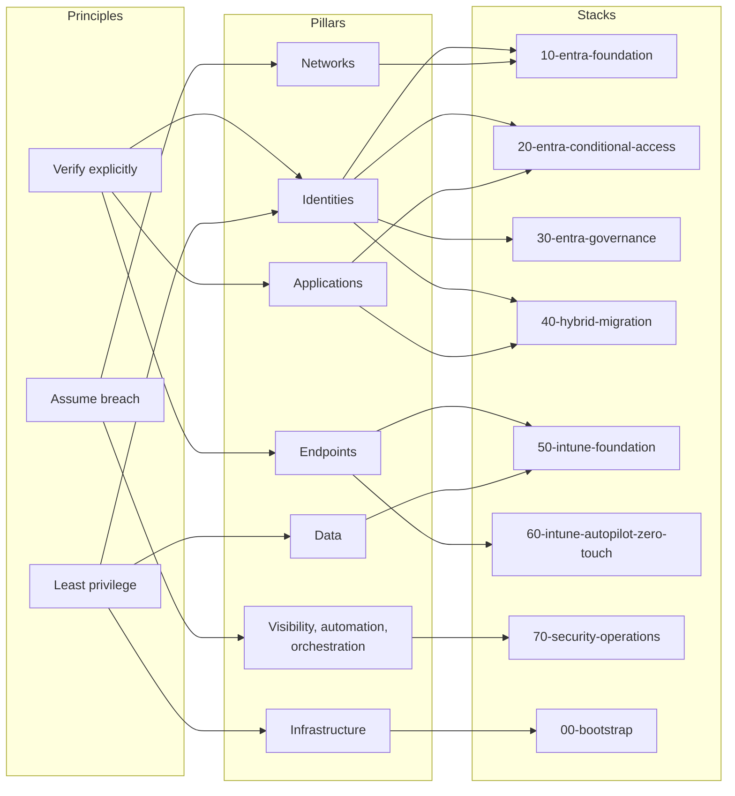

# Zero Trust pillars

Microsoft's Zero Trust model rests on three principles: **verify explicitly**, **use least privilege access** and **assume breach**. Microsoft publishes a deployment guide per technology pillar. This page maps each pillar to the controls the platform delivers.

## Pillar mapping

## Controls per pillar

| Pillar | Microsoft deployment objective | Platform control | Stack |
|---|---|---|---|
| Identities | Phishing-resistant MFA, risk-based access, least privilege | Passkeys and Authenticator, authentication strengths, risk-based CA, PIM | 10, 20, 30 |
| Identities | Cloud authentication, single identity provider | PHS, staged rollout, AD FS retirement | 40 |
| Endpoints | Register and manage devices, enforce compliance | Intune enrolment, compliance policies, security baselines | 50 |
| Endpoints | Zero-touch provisioning | Autopilot user-driven Entra join, device preparation | 60 |
| Applications | Bring apps under Entra ID, apply session controls | AD FS relying party migration, CA session controls | 20, 40 |
| Data | Protect data on unmanaged mobile devices | App protection policies, data protection framework level 2 and 3 | 50 |
| Infrastructure | Secure deployment pipeline and state | OIDC federation, private state storage, Entra-only data plane auth | 00 |
| Networks | Location as a signal, not a perimeter | Named locations used as conditions, never as the sole grant | 10, 20 |
| Visibility and automation | Centralise identity telemetry, detect identity attacks | Diagnostic settings, Sentinel analytics rules, Defender XDR connector | 70 |


Named locations are a signal. No policy grants access solely because a sign-in comes from a trusted network. This follows Microsoft's guidance that network location is no longer a security perimeter.


## References

* [Zero Trust overview](https://learn.microsoft.com/en-us/security/zero-trust/zero-trust-overview)
* [Secure identity with Zero Trust](https://learn.microsoft.com/en-us/security/zero-trust/deploy/identity)
* [Secure endpoints with Zero Trust](https://learn.microsoft.com/en-us/security/zero-trust/deploy/endpoints)
* [Secure applications with Zero Trust](https://learn.microsoft.com/en-us/security/zero-trust/deploy/applications)
* [Secure data with Zero Trust](https://learn.microsoft.com/en-us/security/zero-trust/deploy/data)
* [Secure infrastructure with Zero Trust](https://learn.microsoft.com/en-us/security/zero-trust/deploy/infrastructure)
* [Secure networks with Zero Trust](https://learn.microsoft.com/en-us/security/zero-trust/deploy/networks)
* [Visibility, automation and orchestration with Zero Trust](https://learn.microsoft.com/en-us/security/zero-trust/deploy/visibility-automation-orchestration)
