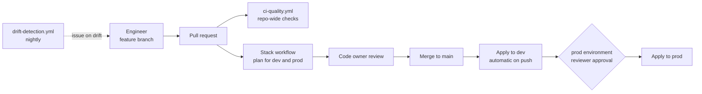

# Deployment overview

All changes reach the tenant through GitHub Actions. Humans propose changes in pull requests and approve production deployments; they do not apply Terraform from their workstations.

## Delivery model

| Page | Covers |
|---|---|
| [GitHub Actions workflows](workflows.md) | Every workflow, its triggers and its pipeline stages |
| [OIDC trust](oidc.md) | How a job obtains Azure and Graph tokens without secrets |
| [Environments](environments.md) | `dev` and `prod`, protection rules, secrets and variables |
| [End-to-end deployment](end-to-end.md) | Stack dependency graph and the orchestration workflow |

## References

* [Use GitHub Actions to connect to Azure with OpenID Connect](https://learn.microsoft.com/en-us/azure/developer/github/connect-from-azure-openid-connect)
* [Store Terraform state in Azure Storage](https://learn.microsoft.com/en-us/azure/developer/terraform/store-state-in-azure-storage)
