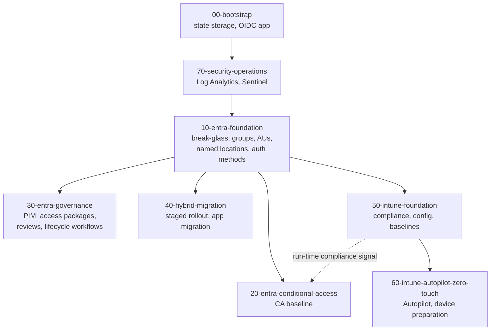

# End-to-end deployment

`end-to-end-deploy.yml` deploys every stack for one environment in dependency order, using `needs` between jobs. It is used for the first deployment of an environment, for rebuilding a test tenant, and for disaster recovery.

## Stack dependency graph



| Stack | Depends on | Why |
|---|---|---|
| `00-bootstrap` | – | Provides the state backend and deployment identities; plan-only in CI |
| `10-entra-foundation` | 70 in the workflow | Creates the groups everything else references. Runs after 70 so that the tenant diagnostic setting and the break-glass sign-in detection are in place before identity changes begin |
| `20-entra-conditional-access` | 10 | References break-glass group, persona groups, named locations, authentication strengths |
| `30-entra-governance` | 10 | Role-assignable groups and administrative units |
| `40-hybrid-migration` | 10 | Naming convention and groups for app assignment |
| `50-intune-foundation` | 10 | Assignment groups |
| `60-intune-autopilot-zero-touch` | 50 | Enrolment configuration and compliance policies |
| `70-security-operations` | 00 | Needs the Azure subscription, the security operations resource group and the apply identity; does not depend on directory objects |


`20-entra-conditional-access` evaluates Intune compliance at run time, not at deploy time. It has no Terraform dependency on `50-intune-foundation`, but device-based policies should not be promoted to enforced until compliance policies are assigned.


## Running it



1. Open **Actions** and select **end-to-end-deploy**.
2. Choose **Run workflow**.
3. Select the environment, set **action** to `apply` (the default `plan` only previews), and start.
4. For `prod`, approve each stack's apply job when prompted.



```bash
gh workflow run end-to-end-deploy.yml -f environment=dev -f action=apply
gh run watch
```



## Behaviour on failure

* A failed job stops every job that depends on it, while independent branches continue. A failure in `50-intune-foundation` stops `60-intune-autopilot-zero-touch` but not `30-entra-governance`; a failure in `70-security-operations` stops everything after it.
* The workflow inputs are `environment` (`dev` or `prod`) and `action` (`plan` or `apply`). A summary job reports the result of every stack.
* Rerun failed jobs from the run page once fixed. Terraform is idempotent, so completed stacks plan no changes.

## References

* [Microsoft Entra deployment plans](https://learn.microsoft.com/en-us/entra/architecture/deployment-plans)
* [Zero Trust deployment plan overview](https://learn.microsoft.com/en-us/security/zero-trust/deploy/overview)
