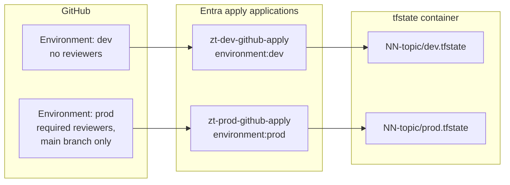

# Environments

The platform uses two GitHub environments, `dev` and `prod`. Each maps to a Terraform variable `environment`, a tfvars file `env/<env>.tfvars` in every stack, and a state key `<NN-topic>/<env>.tfstate`.

## Environment model

## Settings

| Setting | `dev` | `prod` |
|---|---|---|
| Required reviewers | None | At least one, not the author of the change |
| Deployment branches | Any | `main` only |
| Wait timer | None | Optional, for example 5 minutes |
| `ca_state` default | `enabledForReportingButNotEnforced` | `enabledForReportingButNotEnforced` until promoted per policy |
| Tenant | Test tenant or the same tenant with `dev` prefixed objects | Production tenant |

## Secrets and variables

| Name | Kind | Scope | Notes |
|---|---|---|---|
| `AZURE_CLIENT_ID` | Secret | Environment | Client ID of the environment's apply identity |
| `AZURE_PLAN_CLIENT_ID_DEV`, `AZURE_PLAN_CLIENT_ID_PROD` | Secret | Repository | Client IDs of the read-only plan identities |
| `AZURE_TENANT_ID` | Secret | Repository or environment | Tenant ID |
| `AZURE_SUBSCRIPTION_ID` | Secret | Repository or environment | Subscription for state and Log Analytics |
| `TFSTATE_RG` | Variable | Repository or environment | State resource group |
| `TFSTATE_SA` | Variable | Repository or environment | State storage account |


If `dev` and `prod` live in different tenants, set all values at environment level and run the bootstrap once per tenant. Environment-level values override repository-level values.



When `dev` and `prod` share one tenant, both environments change the same directory. Use the `name_prefix` and `environment` naming convention to keep objects separate, and never point `dev` policies at all users.


## References

* [Use GitHub Actions to connect to Azure with OpenID Connect](https://learn.microsoft.com/en-us/azure/developer/github/connect-from-azure-openid-connect)
* [Workload identity federation](https://learn.microsoft.com/en-us/entra/workload-id/workload-identity-federation)
