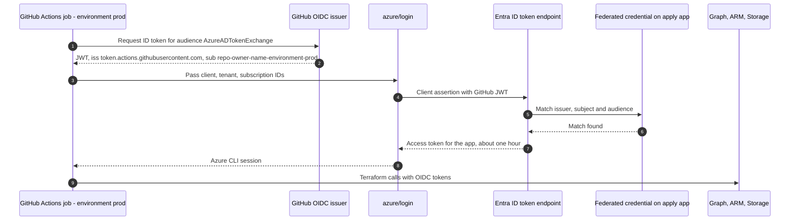

# OIDC trust

The deployment identities are Entra applications with **federated identity credentials** and no secrets. Each environment has two: a read-only **plan** identity and an **apply** identity that only a job running in the protected GitHub environment can use. GitHub's OIDC issuer signs a short-lived token for each job; Entra ID exchanges it for access tokens only if the token's subject matches a configured federated credential. The decision is recorded in [ADR-0004](../architecture/adr/0004-oidc-workload-identity-federation.md).

## Trust sequence

## Federated credentials

| Application | Subjects | Permissions | Used by |
|---|---|---|---|
| `zt-dev-github-plan` | `repo:<owner>/<repo>:pull_request`, `repo:<owner>/<repo>:ref:refs/heads/main` | Read-only Graph, Reader, Storage Blob Data Reader | Plans on pull requests and on `main`, drift detection |
| `zt-dev-github-apply` | `repo:<owner>/<repo>:environment:dev` | Write Graph for enabled stacks, Storage Blob Data Contributor | Apply jobs in the `dev` environment |
| `zt-prod-github-plan` | `repo:<owner>/<repo>:pull_request`, `repo:<owner>/<repo>:ref:refs/heads/main` | Read-only | Plans against `prod` |
| `zt-prod-github-apply` | `repo:<owner>/<repo>:environment:prod` | Write Graph for enabled stacks | Apply jobs in `prod`, after reviewer approval |

Issuer `https://token.actions.githubusercontent.com`, audience `api://AzureADTokenExchange`.


A pull request can only ever obtain a token for a plan identity, which holds read permissions. Even a malicious workflow change in a pull request cannot write to the tenant, because write tokens require the `environment:<env>` subject and `prod` requires a reviewer.


## Subject rules

Application names follow `<name_prefix>-<env>-github-plan|apply`. Subjects are validated to be `environment:<name>`, `pull_request` or `ref:refs/heads|tags/<name>`, with at most 20 per application, which is the Entra limit.

## Rotation

There is nothing to rotate. Changing the repository name, owner, or an environment name requires updating the subjects in `00-bootstrap` before workflows will authenticate again.

## References

* [Workload identity federation](https://learn.microsoft.com/en-us/entra/workload-id/workload-identity-federation)
* [Use GitHub Actions to connect to Azure with OpenID Connect](https://learn.microsoft.com/en-us/azure/developer/github/connect-from-azure-openid-connect)
* [Microsoft Graph permissions reference](https://learn.microsoft.com/en-us/graph/permissions-reference)
