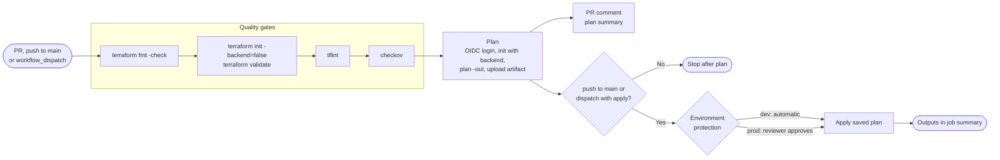

# GitHub Actions workflows

Every stack has its own workflow, and every stack workflow calls one reusable workflow, `_terraform-reusable.yml`, so that the quality gates, plan and apply behaviour are identical everywhere.

## Workflow catalogue

| Workflow | Trigger | Purpose |
|---|---|---|
| `_terraform-reusable.yml` | `workflow_call` with inputs `stack`, `environment`, `action`, and optional `var_file`, `state_key`, `allow_apply`, `terraform_version` | Quality gates, plan, apply |
| `00-bootstrap.yml` | Paths under `terraform/stacks/00-bootstrap/**`, manual | Plan-only (`allow_apply: false`); bootstrap changes are applied by an operator |
| `10-entra-foundation.yml` | Paths under its stack and modules, manual | Tenant baseline |
| `20-entra-conditional-access.yml` | Paths under its stack and modules, manual | Conditional Access baseline |
| `30-entra-governance.yml` | Paths under its stack and modules, manual | PIM, entitlement management, reviews, lifecycle workflows |
| `40-hybrid-migration.yml` | Paths under its stack and modules, manual | Staged rollout, app migration |
| `50-intune-foundation.yml` | Paths under its stack and modules, manual | Intune baseline |
| `60-intune-autopilot.yml` | Paths under `terraform/stacks/60-intune-autopilot-zero-touch/**` and modules, manual | Autopilot and device preparation |
| `70-security-operations.yml` | Paths under its stack and modules, manual | Log Analytics, Sentinel, rules |
| `end-to-end-deploy.yml` | Manual, inputs `environment` (`dev`, `prod`) and `action` (`plan`, `apply`) | All stacks in dependency order |
| `ci-quality.yml` | Pull requests, push to `main` | Repo-wide format, tflint, checkov, gitleaks, PSScriptAnalyzer, markdown lint and link check |
| `drift-detection.yml` | Nightly schedule (03:17 UTC), manual | Plans every stack and environment with the read-only plan identities, `-detailed-exitcode`, opens an issue on drift |

Topic workflows behave the same way for every stack:

| Event | Jobs |
|---|---|
| Pull request | Plan for `dev` and `prod` (matrix), plan summary posted as a PR comment |
| Push to `main` | Apply to `dev`, then apply to `prod` behind the `prod` environment reviewers |
| `workflow_dispatch` | Inputs **environment** (`dev` or `prod`) and **action** (`plan`, `apply` or `destroy-plan`) |

Example: `gh workflow run 20-entra-conditional-access.yml -f environment=prod -f action=plan`.

## Pipeline stages



## Job permissions

```yaml
permissions:
  id-token: write       # request the GitHub OIDC token
  contents: read
  pull-requests: write  # post the plan summary
```

The Azure login step uses `azure/login@v2` with `client-id`, `tenant-id` and `subscription-id` from secrets. Plan jobs use the read-only plan identity (`AZURE_PLAN_CLIENT_ID_DEV` or `AZURE_PLAN_CLIENT_ID_PROD`); apply jobs run inside the GitHub environment and use that environment's `AZURE_CLIENT_ID`, the apply identity. See [OIDC trust](oidc.md). Terraform reads the same identifiers as `ARM_CLIENT_ID`, `ARM_TENANT_ID`, `ARM_SUBSCRIPTION_ID`, with `ARM_USE_OIDC=true`.

## Backend configuration

The backend block in each stack is partial. CI supplies the rest:

```bash
terraform init \
  -backend-config="resource_group_name=$TFSTATE_RG" \
  -backend-config="storage_account_name=$TFSTATE_SA" \
  -backend-config="container_name=tfstate" \
  -backend-config="key=<NN-topic>/<env>.tfstate" \
  -backend-config="use_oidc=true" \
  -backend-config="use_azuread_auth=true"
```


The apply job applies the **saved plan artifact** from the plan job, so what was reviewed is exactly what is applied. If the plan is stale because state moved, the apply fails and the workflow must be rerun.


## Repository quality checks

| Check | Tool | Fails the build |
|---|---|---|
| Terraform formatting | `terraform fmt -check -recursive` | Yes |
| Terraform linting | tflint with the repository `.tflint.hcl` | Yes |
| Policy as code | checkov | Yes |
| Secret scanning | gitleaks | Yes |
| PowerShell analysis | PSScriptAnalyzer on `scripts/` | Yes, on errors |
| Documentation | markdown lint and link check on `docs/` | Yes |

## References

* [Use GitHub Actions to connect to Azure with OpenID Connect](https://learn.microsoft.com/en-us/azure/developer/github/connect-from-azure-openid-connect)
* [Store Terraform state in Azure Storage](https://learn.microsoft.com/en-us/azure/developer/terraform/store-state-in-azure-storage)
* [Terraform on Azure overview](https://learn.microsoft.com/en-us/azure/developer/terraform/overview)
