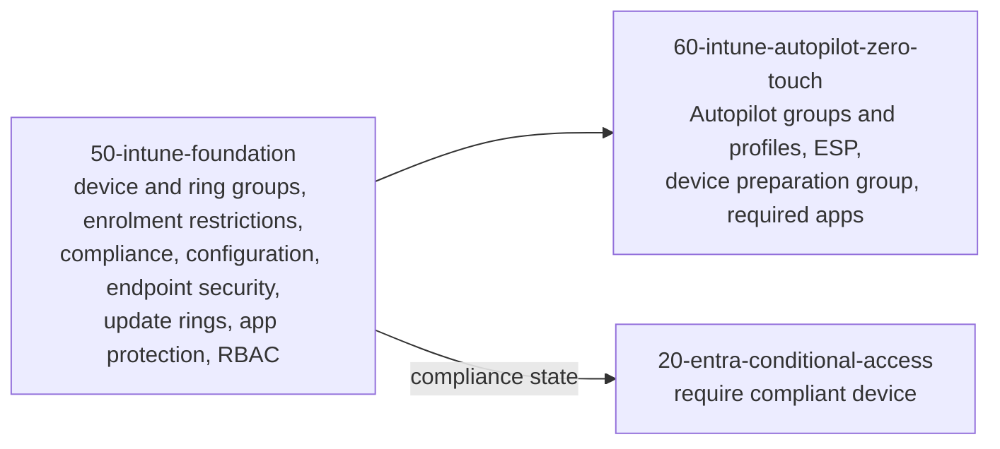

# Endpoint overview

Two stacks deliver the endpoint plane. `50-intune-foundation` sets up Intune and every policy a managed device receives. `60-intune-autopilot-zero-touch` gets new devices into that state without IT touching them.

| Page | Covers |
|---|---|
| [Intune foundation](intune.md) | Tenant setup, policy families, assignment and RBAC |
| [Autopilot zero-touch provisioning](autopilot-zero-touch.md) | OEM to desk sequence, profile types, Apple and Android zero-touch |
| [Compliance and Conditional Access](compliance.md) | How device health becomes an access decision |

## References

* [Secure endpoints with Zero Trust](https://learn.microsoft.com/en-us/security/zero-trust/deploy/endpoints)
* [Intune planning guide](https://learn.microsoft.com/en-us/intune/fundamentals/planning-guide)
* [Intune deployment guide](https://learn.microsoft.com/en-us/intune/fundamentals/setup-migration)
