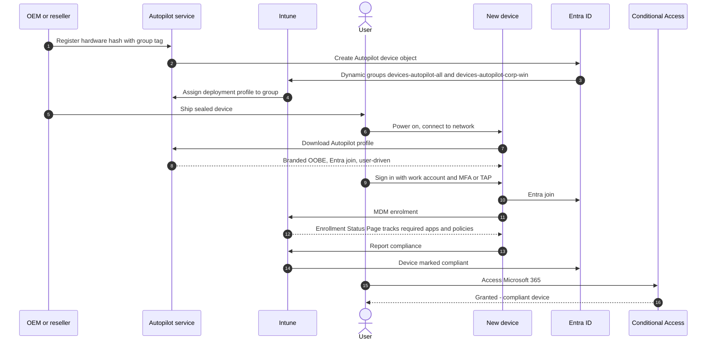
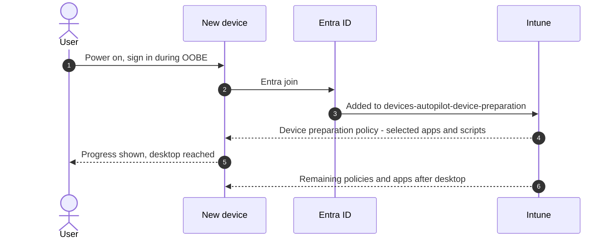

# Autopilot zero-touch provisioning

Stack: `terraform/stacks/60-intune-autopilot-zero-touch` · Workflow: `60-intune-autopilot.yml` · Scripts: `scripts/intune/`

Zero-touch means a device ships from the OEM or reseller directly to the user, who unboxes it, signs in and receives a fully configured, compliant, Entra-joined device. IT never images or handles it.

## Classic Autopilot user-driven sequence

## Device preparation sequence

The choice between the two is recorded in [ADR-0005](../architecture/adr/0005-autopilot-device-preparation.md).

## Profiles delivered

| Object | Assigned to | Group tag | Use case |
|---|---|---|---|
| `zt-<env>-autopilot-user-driven` | `zt-<env>-devices-autopilot-corp-win` | `CORP-WIN` | Knowledge workers, devices registered by the OEM or reseller |
| `zt-<env>-autopilot-pre-provisioned` | `zt-<env>-devices-autopilot-preprov` | `PREPROV` | Large app payloads staged by a partner before shipping |
| `zt-<env>-autopilot-self-deploying` | `zt-<env>-devices-autopilot-kiosk` | `KIOSK` | Kiosks and meeting room devices; requires TPM 2.0 attestation |
| `zt-<env>-autopilot-esp` | `zt-<env>-devices-autopilot-all` | Any | Enrollment Status Page, priority 1 |
| Device preparation policy (portal) | `zt-<env>-devices-autopilot-device-preparation` | None needed | Devices that cannot be pre-registered, Windows 365 |

The dynamic group rule for a tag is `(device.devicePhysicalIds -any (_ -eq "[OrderID]:CORP-WIN"))`. `zt-<env>-devices-autopilot-all` matches every device with a `[ZTDId]`.


Microsoft Graph does not yet publish the schema for device preparation policies. The stack creates the device group, owned by the Intune Provisioning Client service principal. You then create the policy in the Intune admin center under **Devices > Enrollment > Device preparation policies**, selecting that group. If the service principal is missing, create it once with `New-MgServicePrincipal -AppId f1346770-5b25-470b-88bd-d5744ab7952c`.


## Enrollment Status Page

| Setting | Value | Reason |
|---|---|---|
| Show app and profile progress | Yes | User sees what is happening |
| Block device use until required apps install | Yes; Company Portal is the blocking required app | Device is ready before first use |
| Timeout | 60 minutes | Covers large apps on slow links |
| Allow reset on failure | Yes | User can retry without calling IT |

## Hardware hash import

Where the OEM did not register a device, collect the hash with `scripts/intune/Get-AutopilotHardwareHash.ps1`, then upload it with `scripts/intune/Import-AutopilotDevices.ps1 -CsvPath <file> -GroupTag CORP-WIN` (run it with `-WhatIf` first). The group tag is written to the device's OrderID, so the device lands in the matching dynamic group. Use the `group_tags` output of the stack for valid tags.


Hardware hash CSV files identify physical devices. Upload them and delete them; never commit them to the repository.


## Apple and Android zero-touch

| Platform | Programme | Intune configuration |
|---|---|---|
| iOS, iPadOS, macOS | Apple Business Manager with Automated Device Enrollment | ADE token and enrolment profile with user affinity |
| Android | Android Enterprise zero-touch enrolment | Fully managed or corporate-owned work profile enrolment token linked to the zero-touch portal |

The Apple ADE token and the zero-touch portal link require interactive steps in the vendor portals. The stack documents them and creates the Intune-side profiles.

## References

* [Windows Autopilot overview](https://learn.microsoft.com/en-us/autopilot/overview)
* [Windows Autopilot device preparation overview](https://learn.microsoft.com/en-us/autopilot/device-preparation/overview)
* [Compare Autopilot device preparation and Windows Autopilot](https://learn.microsoft.com/en-us/autopilot/device-preparation/compare)
* [User-driven Entra join workflow](https://learn.microsoft.com/en-us/autopilot/tutorial/user-driven/azure-ad-join-workflow)
* [Manually register devices with Windows Autopilot](https://learn.microsoft.com/en-us/autopilot/add-devices)
* [Autopilot requirements](https://learn.microsoft.com/en-us/autopilot/requirements)
* [Enrollment Status Page](https://learn.microsoft.com/en-us/intune/device-enrollment/windows/setup-status-page)
* [Apple Automated Device Enrollment](https://learn.microsoft.com/en-us/intune/device-enrollment/apple/setup-automated-ios)
* [Android Enterprise corporate enrolment methods](https://learn.microsoft.com/en-us/intune/device-enrollment/android/ref-corporate-methods)
