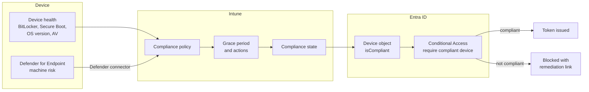

# Compliance and Conditional Access

Compliance turns device health into an access decision. Intune evaluates each device against its compliance policy and writes the result to the device object in Entra ID. Conditional Access reads that result at every token request.

## Signal flow

## Compliance settings

| Setting | Windows | macOS | iOS | Android |
|---|---|---|---|---|
| Encryption | BitLocker | FileVault | Implicit with passcode | Required |
| Integrity | Secure Boot, code integrity | System integrity protection | Not jailbroken | Play Integrity |
| OS version | Minimum supported build | Minimum supported version | Minimum supported version | Minimum supported version |
| Threat | Machine risk at or below Low | Machine risk at or below Low | Device threat level | Device threat level |
| Firewall and AV | Required | Firewall required | – | – |

## Actions for noncompliance

| Day | Action |
|---|---|
| 0 | Mark noncompliant after grace period; email user with remediation steps |
| 1 | Push notification |
| 7 | Email reminder copied to manager |
| 30 | Retire device from management for personally owned devices; flag for review for corporate devices |


Devices without a compliance policy are marked **not compliant** by the tenant-wide compliance setting. That stops unmanaged devices passing the compliant device grant by default.


## Report-only side effects

While device-based Conditional Access policies are in report-only, macOS, iOS and Android users may see a certificate prompt during sign-in. This is expected Microsoft behaviour and is included in user communications before the first deployment.

## References

* [Device compliance overview](https://learn.microsoft.com/en-us/intune/device-security/compliance/overview)
* [Common ways to use Conditional Access with Intune](https://learn.microsoft.com/en-us/intune/device-security/conditional-access-integration/scenarios)
* [Conditional Access report-only mode](https://learn.microsoft.com/en-us/entra/identity/conditional-access/concept-conditional-access-report-only)
* [Manage device identities](https://learn.microsoft.com/en-us/entra/identity/devices/manage-device-identities)
* [Microsoft Defender for Endpoint](https://learn.microsoft.com/en-us/defender-endpoint/microsoft-defender-endpoint)
