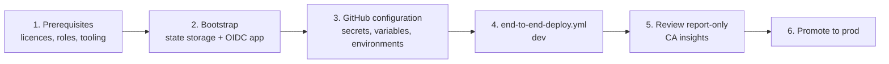

# Overview

Getting the platform running is a three-stage journey. The first stage happens once, by a human, with elevated rights. Everything after it runs through GitHub Actions with no stored secrets.

| Stage | Who | Duration | Output |
|---|---|---|---|
| [Prerequisites](prerequisites.md) | Identity lead, licensing owner | 1 to 5 days | Licences assigned, roles approved, tooling installed |
| [Bootstrap](bootstrap.md) | Privileged identity and subscription owner, once | 1 hour | State storage account, OIDC app registration, federated credentials |
| [First deployment](first-deployment.md) | Platform engineer through GitHub | 1 to 2 hours | All stacks deployed to `dev`, Conditional Access in report-only |


Never run the bootstrap against a production tenant before you have exercised it end to end in a non-production tenant. The Microsoft 365 developer programme or a dedicated test tenant is suitable.


## References

* [Microsoft Entra deployment plans](https://learn.microsoft.com/en-us/entra/architecture/deployment-plans)
* [Zero Trust deployment plan overview](https://learn.microsoft.com/en-us/security/zero-trust/deploy/overview)
* [Use GitHub Actions to connect to Azure with OpenID Connect](https://learn.microsoft.com/en-us/azure/developer/github/connect-from-azure-openid-connect)
