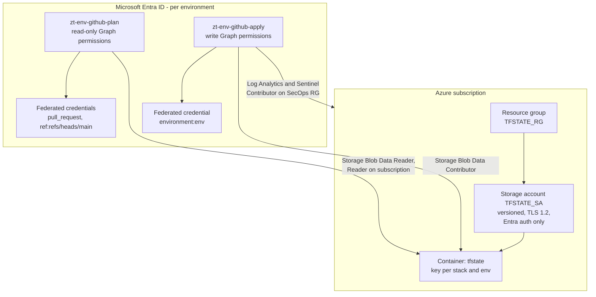

# Bootstrap the platform

The bootstrap solves the chicken-and-egg problem: GitHub Actions needs a Terraform state backend and an identity to deploy with, and both must exist before any workflow can run. It is executed **once** per tenant by a human; afterwards the `00-bootstrap.yml` workflow plans it and watches it for drift.

## What the bootstrap creates

| Resource | Setting | Why |
|---|---|---|
| Storage account | Shared key access disabled, OAuth by default; network access and IP allow-list set by `state_public_network_access` and `state_allowed_ip_ranges` | State contains object IDs and policy definitions; access is through Entra ID only |
| Storage account and container | `prevent_destroy` lifecycle | A mistaken destroy can never remove all state |
| Storage account | Blob versioning and soft delete | Recover a corrupted state file without a backup restore |
| Storage account | Minimum TLS 1.2 | Microsoft baseline |
| App registrations | Two per environment: `<prefix>-<env>-github-plan` and `<prefix>-<env>-github-apply`; no client secret, no certificate | Plan jobs can never write; see [OIDC trust](../deployment/oidc.md) |
| Federated credentials | Plan identity trusts `pull_request` and `ref:refs/heads/main`; apply identity trusts only `environment:<env>` | Only a job running in the protected GitHub environment can obtain write tokens |
| Graph permissions | Read-only for plan, least privilege write for apply, granted only for enabled stacks | Listed in [Graph permissions per stack](../reference/graph-permissions.md) |

## Procedure



### Sign in with elevated rights

On the bootstrap workstation, sign in to Azure CLI as an operator who holds Owner (or Contributor plus Role Based Access Control Administrator) on the target subscription, and Privileged Role Administrator plus Cloud Application Administrator (or Global Administrator) in Entra ID. Confirm the tenant and subscription shown are the intended ones before continuing.



### Run the bootstrap script

Run `scripts/bootstrap/Initialize-Bootstrap.ps1 -WhatIf` first to review what it will create, then without `-WhatIf`. The script applies `terraform/stacks/00-bootstrap` with a local backend, creates the state storage account and the OIDC application, and then migrates the local state into the new storage account under the key `00-bootstrap/<env>.tfstate`.



### Record the outputs

Capture the outputs `github_apply_client_ids`, `github_plan_client_ids`, `tenant_id`, `subscription_id`, `tfstate_resource_group` and `tfstate_storage_account`. None of these values are secrets, but they are stored as GitHub secrets to keep tenant identifiers out of logs.



### Configure GitHub

Rerunning the bootstrap with `-ConfigureGitHub -ProdReviewer <github-user>` uses the GitHub CLI to create the `dev` and `prod` environments and set everything below. To do it by hand, create the secrets and variables at repository level, or per environment if `dev` and `prod` use different tenants or subscriptions.

| Name | Type | Value |
|---|---|---|
| `AZURE_CLIENT_ID` | Environment secret in `dev` and in `prod` | Client ID of that environment's apply identity |
| `AZURE_PLAN_CLIENT_ID_DEV`, `AZURE_PLAN_CLIENT_ID_PROD` | Repository secrets | Client IDs of the read-only plan identities |
| `AZURE_TENANT_ID` | Secret | Directory (tenant) ID |
| `AZURE_SUBSCRIPTION_ID` | Secret | Subscription that holds state and Log Analytics |
| `TFSTATE_RG` | Variable | Resource group of the state storage account |
| `TFSTATE_SA` | Variable | Name of the state storage account |



### Remove the human foothold

Sign out of Azure CLI, delete the local `.terraform` directory and any local state copy. From now on `00-bootstrap.yml` plans the stack on every change and detects drift. Changes to the deployment identities or their permissions are applied by an elevated operator rerunning `Initialize-Bootstrap.ps1`, because the pipeline deliberately cannot grant itself rights.




Do not create a client secret on the deployment application "temporarily". A secret defeats the purpose of workload identity federation and will be flagged by the `ci-quality.yml` secret scan if it ever reaches the repository.


## Verify

* The `00-bootstrap.yml` workflow, triggered manually with action `plan`, completes with no changes.
* The storage account blade shows **Allow storage account key access: Disabled**.
* Each app registration's **Certificates and secrets** blade shows only federated credentials.

## References

* [Store Terraform state in Azure Storage](https://learn.microsoft.com/en-us/azure/developer/terraform/store-state-in-azure-storage)
* [Blob versioning](https://learn.microsoft.com/en-us/azure/storage/blobs/versioning-overview)
* [Workload identity federation](https://learn.microsoft.com/en-us/entra/workload-id/workload-identity-federation)
* [Use GitHub Actions to connect to Azure with OpenID Connect](https://learn.microsoft.com/en-us/azure/developer/github/connect-from-azure-openid-connect)
* [Microsoft Graph permissions reference](https://learn.microsoft.com/en-us/graph/permissions-reference)
