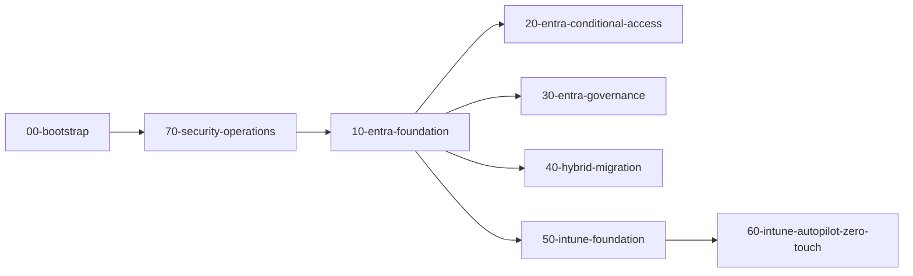

# First end-to-end deployment

With the bootstrap complete and GitHub configured, deploy every stack to `dev` in dependency order using `end-to-end-deploy.yml`.

## Stack order



The full dependency rationale is in [End-to-end deployment](../deployment/end-to-end.md).

## Procedure



### Start the workflow

In GitHub, open **Actions**, select **end-to-end-deploy**, choose **Run workflow**, set **environment** to `dev` and **action** to `apply`, then start it. The default action, `plan`, only previews; downstream plans may show unknown values until upstream stacks are applied. The GitHub CLI equivalent is:

```bash
gh workflow run end-to-end-deploy.yml -f environment=dev -f action=apply
```



### Watch the quality gates

Each stack runs format, validate, tflint and checkov before its plan. `00-bootstrap` is plan-only in CI. A failure in any gate stops that stack and every stack that depends on it.



### Review each plan

Plans are uploaded as artifacts and summarised in the run. With `action=apply`, `dev` applies without waiting. For `prod`, every apply waits for an environment reviewer.



### Validate the outcome

| Check | Where |
|---|---|
| Two break-glass accounts exist and are excluded from all policies | Entra admin center, Users and Conditional Access |
| All Conditional Access policies show **Report-only** | Entra admin center, Conditional Access, Policies |
| Authentication methods policy enables passkeys, Authenticator and TAP; SMS and voice disabled | Entra admin center, Authentication methods |
| Compliance policies and security baselines assigned | Intune admin center, Devices |
| Autopilot profile and device preparation policy present | Intune admin center, Devices, Enrollment |
| Entra ID logs flowing into the Log Analytics workspace | `SigninLogs` and `AuditLogs` tables return rows |



### Leave Conditional Access in report-only

Run for at least 7 days, preferably 14, before promoting any policy. Follow [Conditional Access promotion](../operations/ca-promotion.md).




When `dev` is green and reviewed, repeat the run with `environment=prod` and `action=apply`. Approvals are enforced by the `prod` environment protection rules.


## References

* [Plan a Conditional Access deployment](https://learn.microsoft.com/en-us/entra/identity/conditional-access/plan-conditional-access)
* [Conditional Access report-only mode](https://learn.microsoft.com/en-us/entra/identity/conditional-access/concept-conditional-access-report-only)
* [Configure Microsoft Entra diagnostic settings](https://learn.microsoft.com/en-us/entra/identity/monitoring-health/howto-configure-diagnostic-settings)
