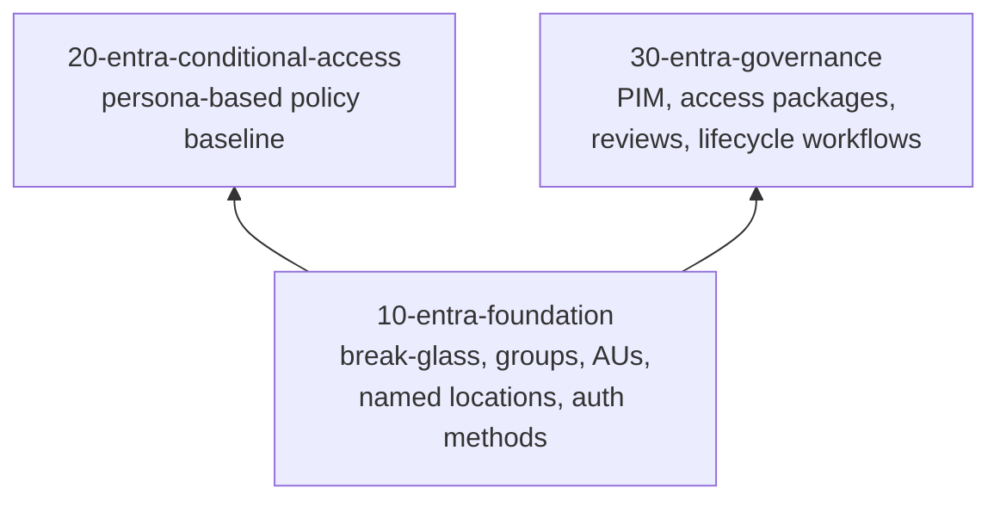

# Identity overview

Microsoft Entra ID is the identity and access plane. Three stacks build it in layers: a tenant foundation, a Conditional Access policy set on top of it, and identity governance to keep access right over time.

| Page | Covers |
|---|---|
| [Entra foundation](entra-foundation.md) | Emergency access, groups, administrative units, named locations, authentication methods policy and strengths |
| [Conditional Access](conditional-access.md) | Policy decision flow, persona matrix, baseline policy catalogue |
| [Identity governance](governance.md) | Entitlement management, access reviews, lifecycle workflows |
| [Privileged Identity Management](pim.md) | Eligible assignments, activation, approval and PIM for Groups |

## References

* [Secure identity with Zero Trust](https://learn.microsoft.com/en-us/security/zero-trust/deploy/identity)
* [Microsoft Entra deployment plans](https://learn.microsoft.com/en-us/entra/architecture/deployment-plans)
* [Configure Microsoft Entra security features](https://learn.microsoft.com/en-us/entra/fundamentals/configure-security)
