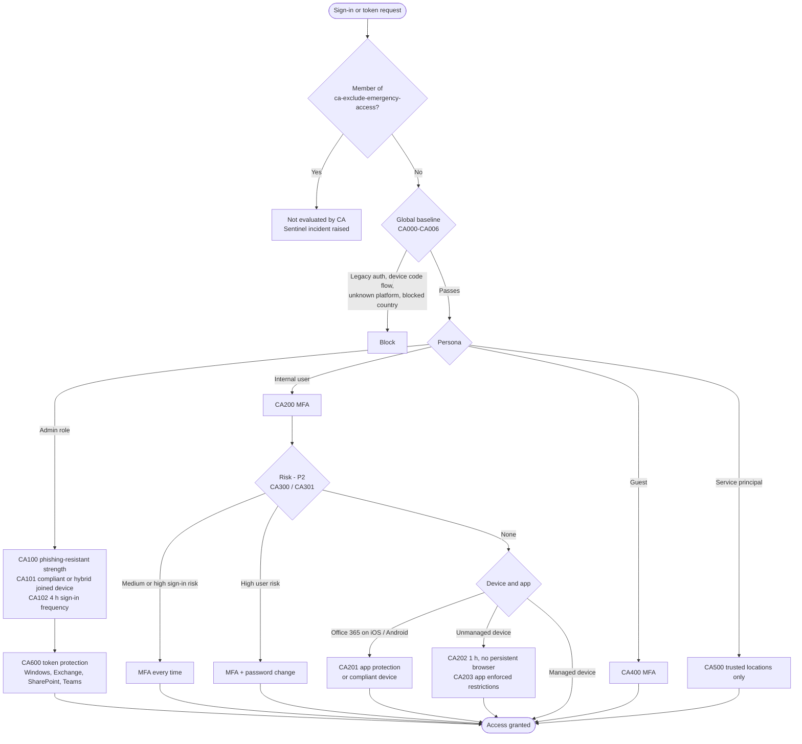

# Conditional Access

Stack: `terraform/stacks/20-entra-conditional-access` · Module: `terraform/modules/entra-conditional-access` · Workflow: `20-entra-conditional-access.yml`

Conditional Access is the Zero Trust policy engine. For every token request it evaluates signals about the user, device, application, location and risk, then grants, blocks or limits the session. The baseline follows Microsoft's Conditional Access policy templates and the persona-based Zero Trust framework. There are 19 policies, numbered by persona range: `CA0xx` Global, `CA1xx` Admins, `CA2xx` Internals, `CA3xx` risk-based for Internals, `CA4xx` Guests, `CA5xx` Workload identities and `CA6xx` token protection.

## Decision flow


Conditional Access evaluates **every** policy that applies, and the user must satisfy all of their grant controls. The flowchart helps you read the policy set; the engine itself does not run policies one after another.


## Policy catalogue

Display names follow `<prefix>-<env>-CA<nnn>-<Persona>-<Purpose>-<Apps>-<Platform>-<Control>`, for example `zt-prod-CA000-Global-BaseProtection-AllApps-AnyPlatform-Block-LegacyAuthentication`.

| # | Persona | Policy | Feature flag | Licence |
|---|---|---|---|---|
| CA000 | Global | Block legacy authentication | – | P1 |
| CA001 | Global | Block device code flow and authentication transfer | – | P1 |
| CA002 | Global | Block unknown or unsupported device platforms | – | P1 |
| CA003 | Global | Block sign-in from blocked countries | `enable_country_block` | P1 |
| CA004 | Global | Register security info from untrusted networks only with TAP or a strong method | – | P1 |
| CA005 | Global | Require MFA to register or join devices | – | P1 |
| CA006 | Global | Require MFA for Azure management | – | P1 |
| CA100 | Admins | Require phishing-resistant MFA (custom authentication strength) | – | P1 |
| CA101 | Admins | Require compliant or Microsoft Entra hybrid joined device | – | P1 + Intune |
| CA102 | Admins | Sign-in frequency 4 hours, no persistent browser | – | P1 |
| CA200 | Internals | Require MFA for all users (service accounts and the sync role excluded) | – | P1 |
| CA201 | Internals | Office 365 on iOS and Android: app protection policy or compliant device | – | P1 + Intune |
| CA202 | Internals | Unmanaged devices: 1 hour sign-in frequency, no persistent browser | – | P1 |
| CA203 | Internals | Office 365 in the browser on unmanaged devices: app enforced restrictions | – | P1 |
| CA300 | Internals | Medium or high sign-in risk: MFA every time | `enable_risk_policies` | P2 |
| CA301 | Internals | High user risk: MFA and password change | `enable_risk_policies` | P2 |
| CA400 | Guests | Require MFA for all guest and external user types | – | P1 |
| CA500 | Workload identities | Block service principals outside trusted locations | `enable_workload_identity_policy` | Workload ID Premium |
| CA600 | Admins | Token protection for Exchange, SharePoint and Teams on Windows | `enable_token_protection` | P1 |

## Persona and policy matrix

Legend: **✓** applies, **–** does not apply. The emergency access group is excluded from every policy.

| Policy | Internals | Admins | Guests | Workload identities |
|---|---|---|---|---|
| CA000-CA002 Global blocks | ✓ | ✓ | ✓ | – |
| CA003 Blocked countries | ✓ | ✓ | ✓ | – |
| CA004 Security info registration | ✓ | ✓ | – | – |
| CA005 MFA to register or join devices | ✓ | ✓ | ✓ | – |
| CA006 MFA for Azure management | ✓ | ✓ | ✓ | – |
| CA100-CA102 Admin strength, device, session | – | ✓ | – | – |
| CA200 MFA | ✓ | ✓ | – | – |
| CA201 Mobile app protection | ✓ | – | – | – |
| CA202-CA203 Unmanaged device session | ✓ | – | – | – |
| CA300-CA301 Risk-based | ✓ | – | – | – |
| CA400 Guest MFA | – | – | ✓ | – |
| CA500 Trusted locations | – | – | – | ✓ |
| CA600 Token protection | – | ✓ | – | – |

## Configuration

| Variable | Default | Purpose |
|---|---|---|
| `ca_state` | `enabledForReportingButNotEnforced` | State for every policy |
| `policy_state_overrides` | `{}` | Per-policy state, for example `{ CA000 = "enabled" }`, used to promote one policy at a time |
| `enable_risk_policies` | `true` | CA300 and CA301; needs Microsoft Entra ID P2 for every user in scope |
| `enable_country_block` | `true` | CA003, using the blocked countries named location |
| `enable_workload_identity_policy` | `false` | CA500; needs Workload Identities Premium |
| `enable_token_protection` | `true` | CA600; created through `msgraph_resource` because the token protection session control is only in Graph `beta` |
| `admin_sign_in_frequency_hours` | `4` | CA102 sign-in frequency |

## Guardrails in code

* Every policy excludes `<prefix>-<env>-ca-exclude-emergency-access`.
* Every policy starts in report-only; see [ADR-0003](../architecture/adr/0003-conditional-access-report-only-first.md).
* Admin policies target directory **role template IDs**, so new administrators are covered without group maintenance.
* CA200 excludes `<prefix>-<env>-persona-service-accounts` and the directory synchronisation role.
* The built-in "Multifactor authentication" strength is referenced by its fixed ID. Custom strengths (`<prefix>-<env>-as-phishing-resistant-admins`, `<prefix>-<env>-as-security-info-registration`) and the named location `<prefix>-<env>-nl-blocked-countries` are looked up by display name from `10-entra-foundation`.

## Promotion

Promote policies one at a time through `policy_state_overrides`, following the [Conditional Access promotion runbook](../operations/ca-promotion.md). Suggested order: CA000, CA001, CA004, CA005, CA100, CA200, CA400, CA002, then the rest. Enable CA101 and CA201 only after `50-intune-foundation` compliance and app protection policies are assigned and devices report compliant.

## References

* [Conditional Access overview](https://learn.microsoft.com/en-us/entra/identity/conditional-access/overview)
* [Plan a Conditional Access deployment](https://learn.microsoft.com/en-us/entra/identity/conditional-access/plan-conditional-access)
* [Conditional Access policy templates](https://learn.microsoft.com/en-us/entra/identity/conditional-access/concept-conditional-access-policy-common)
* [Building a Conditional Access policy](https://learn.microsoft.com/en-us/entra/identity/conditional-access/concept-conditional-access-policies)
* [Block legacy authentication](https://learn.microsoft.com/en-us/entra/identity/conditional-access/policy-block-legacy-authentication)
* [Require MFA strength for all users](https://learn.microsoft.com/en-us/entra/identity/conditional-access/policy-all-users-mfa-strength)
* [Token protection](https://learn.microsoft.com/en-us/entra/identity/conditional-access/concept-token-protection)
* [Conditional Access report-only mode](https://learn.microsoft.com/en-us/entra/identity/conditional-access/concept-conditional-access-report-only)
* [Microsoft Entra ID Protection](https://learn.microsoft.com/en-us/entra/id-protection/overview-identity-protection)
