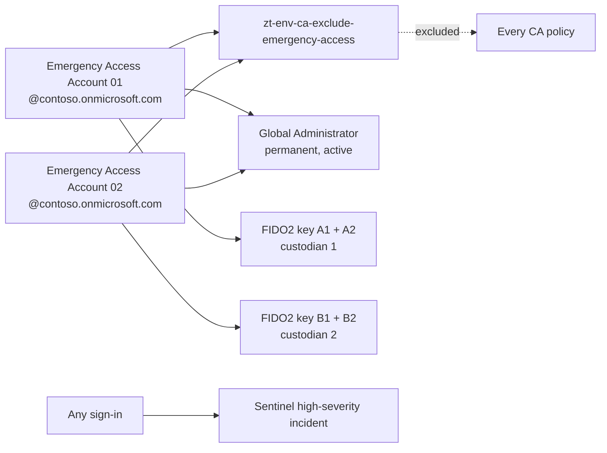

# Entra foundation

Stack: `terraform/stacks/10-entra-foundation` · Workflow: `10-entra-foundation.yml`

The foundation stack creates the objects every other stack depends on. It changes rarely and is reviewed carefully because a mistake here can affect every sign-in.

## Components

| Component | Design | Microsoft guidance |
|---|---|---|
| Emergency access accounts | Two cloud-only accounts on the initial `onmicrosoft.com` domain, Global Administrator permanently assigned, FIDO2 keys as primary method with a split random password as fallback, excluded from all Conditional Access through the role-assignable `ca-exclude-emergency-access` group | Manage emergency access accounts |
| Security groups | Persona groups (`persona-internals`, `persona-guests`, `persona-admins`, `persona-developers`, `persona-external-partners`, `persona-service-accounts`), `pim-*` role groups and `pim-approvers`, governance groups, `ca-pilot-users`, `users-new-hires`. Intune device groups are owned by stacks 50 and 60, not here | Conditional Access deployment plan |
| Administrative units | `users-standard` (Helpdesk Administrator scope for `pim-helpdesk-administrators`), `devices-corporate`, `tier0-accounts` | Administrative units |
| Named locations | Trusted corporate egress ranges, allowed countries and blocked countries (`nl-blocked-countries`, used by CA003), used as conditions only | Network assignment in Conditional Access |
| Authentication methods policy | Passkeys (FIDO2), Microsoft Authenticator with app name and location context, one-time Temporary Access Pass, SMS and voice disabled, registration campaign | Manage authentication methods |
| Authentication strengths | Custom `as-phishing-resistant-admins`, `as-passwordless-mfa` and `as-security-info-registration` | Authentication strengths |
| Custom security attributes | Optional `ZeroTrust` attribute set, enabled with `enable_custom_security_attributes` | Custom security attributes |
| Company branding | Sign-in page branding documented, applied in the portal because image upload has no stable Terraform surface | Company branding |

## Break-glass design


Terraform creates each account with a random 64-character password, available only through the sensitive `emergency_access_initial_passwords` output and stored in the private state backend. After the first apply, read it on a trusted workstation, split each password between the two custodians, and register two FIDO2 keys per account, stored in separate safes. Passwords never enter the repository, a ticket or a pipeline log.


## Authentication methods rollout



### Enable modern methods

Enable passkeys and Microsoft Authenticator for all users, with number matching and additional context.



### Run a registration campaign

Prompt users without Authenticator to register it at sign-in. Use Temporary Access Pass for users who have no method yet.



### Disable weak methods

After registration coverage passes the agreed threshold, disable SMS and voice. Method states are stack variables, so the change is a reviewed pull request.



### Require strength through Conditional Access

Use authentication strengths in `20-entra-conditional-access` so administrators must use phishing-resistant methods.



## References

* [Manage emergency access accounts](https://learn.microsoft.com/en-us/entra/identity/role-based-access-control/security-emergency-access)
* [Administrative units](https://learn.microsoft.com/en-us/entra/identity/role-based-access-control/administrative-units)
* [Network assignment in Conditional Access](https://learn.microsoft.com/en-us/entra/identity/conditional-access/concept-assignment-network)
* [Manage authentication methods](https://learn.microsoft.com/en-us/entra/identity/authentication/concept-authentication-methods-manage)
* [Authentication strengths](https://learn.microsoft.com/en-us/entra/identity/authentication/concept-authentication-strengths)
* [Enable passkeys (FIDO2)](https://learn.microsoft.com/en-us/entra/identity/authentication/how-to-enable-passkey-fido2)
* [Number matching in Microsoft Authenticator](https://learn.microsoft.com/en-us/entra/identity/authentication/how-to-mfa-number-match)
* [Temporary Access Pass](https://learn.microsoft.com/en-us/entra/identity/authentication/howto-authentication-temporary-access-pass)
* [Custom security attributes](https://learn.microsoft.com/en-us/entra/fundamentals/custom-security-attributes-overview)
