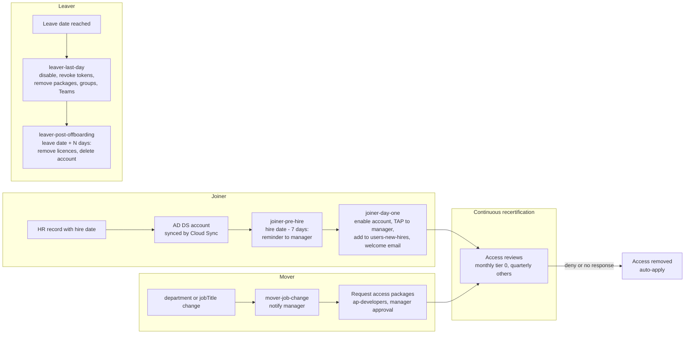

# Identity governance

Stack: `terraform/stacks/30-entra-governance` · Workflow: `30-entra-governance.yml`

Governance ensures the right people have the right access for the right time, and that access is removed when it is no longer needed. The stack implements Microsoft Entra ID Governance: entitlement management, access reviews, lifecycle workflows and PIM. PIM is described separately in [Privileged Identity Management](pim.md).

## Joiner, mover, leaver lifecycle

## Entitlement management

| Package | Catalog | Requestors | Approval | Duration | Review |
|---|---|---|---|---|---|
| `ap-global-administrators`, `ap-privileged-role-administrators`, `ap-privileged-authentication-administrators` | privileged-access | `persona-admins` (dedicated admin accounts), hidden | `pim-approvers` | 90 days | Quarterly by approvers |
| `ap-developers` | workforce | All members | Manager | 180 days | Quarterly by manager |
| `ap-external-partners` | partners | Existing directory users and guests | `governance-partner-sponsors` | 90 days, no extension | Quarterly by sponsors |

The tier-0 packages grant membership of the PIM-eligible `pim-*` groups, so getting tier-0 access takes two steps: an approved package assignment, then a just-in-time role activation. See [Privileged Identity Management](pim.md).

## Access reviews

| Review | Scope | Frequency | On no response |
|---|---|---|---|
| Tier-0 groups | `pim-global-administrators`, `pim-privileged-role-administrators`, `pim-privileged-authentication-administrators` | Monthly, 7-day window | Deny and auto-apply |
| Tier-1 and tier-2 groups | Other `pim-*` groups | Quarterly | Deny and auto-apply |
| Emergency access exclusion group and service accounts | `ca-exclude-emergency-access`, `persona-service-accounts` | Quarterly | **No default decision, no auto-apply** |
| Inactive guests | Guests inactive for 90 days in every Microsoft 365 group | Quarterly, by group owners | Deny and auto-apply |


The emergency access review never auto-applies. An unanswered review must never remove an emergency access account from the exclusion group.


## Lifecycle workflows

| Workflow | Trigger | Tasks |
|---|---|---|
| `joiner-pre-hire` | Hire date minus 7 days | Onboarding reminder to manager |
| `joiner-day-one` | Hire date | Enable account, one-time Temporary Access Pass to manager, add to `users-new-hires`, welcome email |
| `mover-job-change` | `department` or `jobTitle` change | Notify manager |
| `leaver-last-day` | Leave date | Disable account, revoke tokens, remove access packages, groups and Teams, email manager |
| `leaver-post-offboarding` | Leave date plus N days | Remove licences, delete account |


Workflows are created with scheduling **off**. Run them on demand, check the results, then set `lifecycle_scheduling_enabled = true`. Lifecycle workflows need the Microsoft Entra ID Governance licence and reliable `employeeHireDate` and `employeeLeaveDateTime` values flowing from HR through AD DS and Cloud Sync.


## References

* [Entitlement management overview](https://learn.microsoft.com/en-us/entra/id-governance/entitlement-management-overview)
* [Create an access package](https://learn.microsoft.com/en-us/entra/id-governance/entitlement-management-access-package-create)
* [Access reviews overview](https://learn.microsoft.com/en-us/entra/id-governance/access-reviews-overview)
* [What are lifecycle workflows](https://learn.microsoft.com/en-us/entra/id-governance/what-are-lifecycle-workflows)
* [Microsoft Entra ID Governance licensing fundamentals](https://learn.microsoft.com/en-us/entra/id-governance/licensing-fundamentals)
