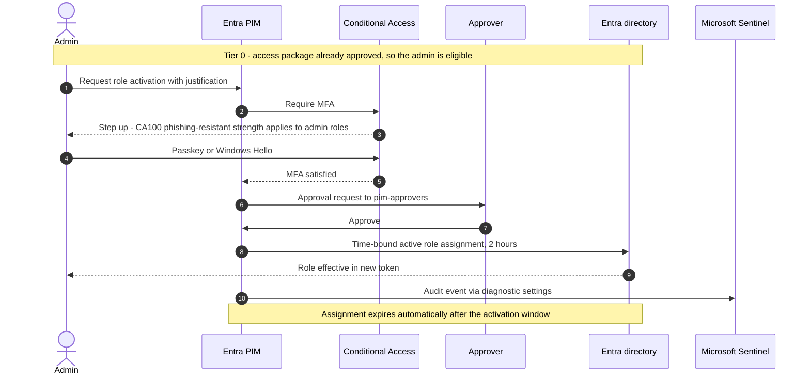

# Privileged Identity Management

Stack: `terraform/stacks/30-entra-governance` · Workflow: `30-entra-governance.yml`

No human holds a standing privileged role, apart from the two break-glass accounts. Administrators are **eligible** and activate just in time, with MFA, justification and, for tier-0 roles, approval.

## Model

* Tier-0 roles are bound to `pim-*` groups through **PIM-eligible** role assignments. Getting into the group takes an approved access package; using the role takes a just-in-time activation.
* Tier-1 and tier-2 groups hold their role **actively**. People are **eligible members** of the group (PIM for Groups) and activate membership just in time.
* Role management policies set activation duration, MFA, justification and approval per tier.
* Emergency access accounts keep permanent Global Administrator and sit outside this model.

| Tier | Groups | Role binding | How a person gets access |
|---|---|---|---|
| 0 | `pim-global-administrators`, `pim-privileged-role-administrators`, `pim-privileged-authentication-administrators` | Group is PIM-eligible for the role | Request the hidden access package (dedicated admin accounts only), approved by `pim-approvers`, valid 90 days; then activate the role for 2 hours with MFA, justification and approval |
| 1 | `pim-security-administrators`, `pim-conditional-access-administrators`, `pim-intune-administrators`, `pim-user-administrators`, `pim-global-readers`, `pim-security-readers` | Group holds the role actively | Eligible member activates group membership for 4 hours with MFA and justification |
| 2 | `pim-helpdesk-administrators` | Helpdesk Administrator scoped to the `users-standard` administrative unit | Same as tier 1 |

## Activation sequence

## Guardrails

* No permanent active assignments for people in tier 0; the stack only creates eligible assignments for tier-0 groups.
* Tier-0 group membership expires with the 90-day access package assignment and is reviewed monthly.
* Activation of Global Administrator and activations outside business hours raise the **PIM role activation outside business hours** Sentinel incident.
* The apply deployment identities hold the directory permissions they need for deployment. They are the only non-human standing privileged principals, and their permissions are reviewed every quarter.


PIM requires Microsoft Entra ID P2 or Microsoft Entra ID Governance for every user who is eligible or who approves.


## References

* [What is Privileged Identity Management](https://learn.microsoft.com/en-us/entra/id-governance/privileged-identity-management/pim-configure)
* [Plan a PIM deployment](https://learn.microsoft.com/en-us/entra/id-governance/privileged-identity-management/pim-deployment-plan)
* [PIM for Groups](https://learn.microsoft.com/en-us/entra/id-governance/privileged-identity-management/concept-pim-for-groups)
* [Best practices for Microsoft Entra roles](https://learn.microsoft.com/en-us/entra/identity/role-based-access-control/best-practices)
* [Privileged access workstations](https://learn.microsoft.com/en-us/security/privileged-access-workstations/overview)
