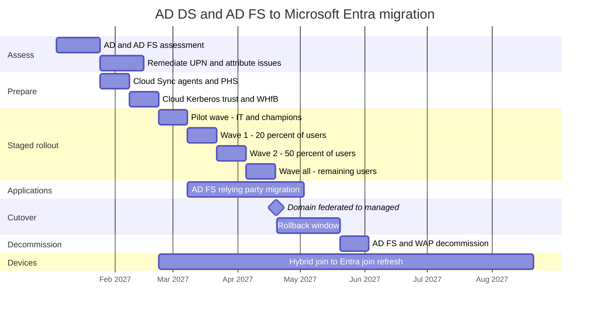

# AD DS to Entra migration

Stack: `terraform/stacks/40-hybrid-migration` · Workflow: `40-hybrid-migration.yml` · Scripts: `scripts/hybrid-migration/`

The migration moves authentication from AD FS to Microsoft Entra ID, moves applications from AD FS relying parties to Entra enterprise applications, and moves devices from hybrid join to Entra join. It follows Microsoft's guide *Migrate from federation to cloud authentication* and uses **staged rollout** so that users move in controlled waves before the domain is converted.

## Division of labour

| Concern | Terraform (`40-hybrid-migration`) | PowerShell (`scripts/hybrid-migration/`) |
|---|---|---|
| Wave groups `<prefix>-<env>-hybrid-wave-{pilot,wave1,wave2,all}` | Creates | Populates in batches |
| Feature rollout policies for password hash sync and Seamless SSO | Creates and attaches waves | – |
| Enterprise apps replacing AD FS relying parties | Creates, with claims and assignments | Inventories relying parties |
| Group source of authority conversion | Converts selected groups | – |
| AD DS readiness, sync health | – | Assesses and reports |
| Domain federated to managed conversion | – | Interactive cutover with prechecks |
| Rollback | Reverts wave attachment | Re-federates domain if required |

## Phases

| Phase | Outcome | Terraform change | Script |
|---|---|---|---|
| 0 Assess | AD hygiene report, AD FS relying party inventory, device join report | None | `Invoke-ADReadinessAssessment.ps1`, `Get-ADFSRelyingPartyInventory.ps1`, `Get-DeviceJoinStateReport.ps1` |
| 1 Prepare | Routable UPN suffixes, Cloud Sync with PHS running, Seamless SSO and cloud Kerberos trust ready | Apply with no waves enabled | `Test-HybridSyncHealth.ps1` |
| 2 Pilot | Pilot users authenticate in the cloud | Enable `pilot` wave | `Start-StagedRolloutWave.ps1` |
| 3 Waves | `wave1`, `wave2`, `all` migrated | Append one wave per pull request | `Start-StagedRolloutWave.ps1` |
| 4 Apps | AD FS relying parties repointed to Entra | Add migrated applications | – |
| 5 Cutover | Domain converted to managed | None, then disable staged rollout | `Convert-DomainToManaged.ps1` |
| 6 Decommission | AD FS farm and WAP removed, groups cloud managed | Remove waves, convert groups | – |

## Migration waves


The dates are an example plan. Durations come from Microsoft's recommendation to pilot, measure and expand, and from the 30-day rollback window kept before AD FS is removed.


## Pages

* [Assessment and readiness](assessment.md)
* [Cutover runbooks](cutover-runbooks.md)
* [Migration rollback](rollback.md)

## References

* [Migrate from federation to cloud authentication](https://learn.microsoft.com/en-us/entra/identity/hybrid/connect/migrate-from-federation-to-cloud-authentication)
* [Cloud authentication with staged rollout](https://learn.microsoft.com/en-us/entra/identity/hybrid/connect/how-to-connect-staged-rollout)
* [AD FS application migration overview](https://learn.microsoft.com/en-us/entra/identity/enterprise-apps/migrate-adfs-apps-phases-overview)
* [What is Microsoft Entra Cloud Sync](https://learn.microsoft.com/en-us/entra/identity/hybrid/cloud-sync/what-is-cloud-sync)
* [Password hash synchronization](https://learn.microsoft.com/en-us/entra/identity/hybrid/connect/whatis-phs)
