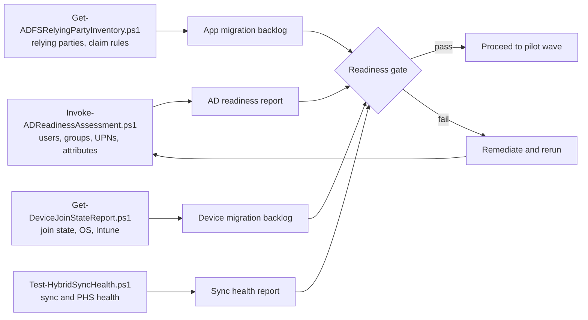

# Assessment and readiness

Assessment answers three questions before any user moves: is the directory clean enough to synchronise, which applications depend on AD FS, and which devices can move to Entra join.

## Assessment workflow

All scripts run with PowerShell 7 and write reports locally. Scripts that change anything run in preview mode unless `-Execute` is supplied. Reports may contain personal data; store them in the project's restricted location, never in the repository.

## Directory readiness

| Check | Why it matters | Target |
|---|---|---|
| UPN suffix is a verified, routable domain | Users sign in with their UPN; `.local` suffixes cannot be verified | 100 percent routable |
| Duplicate `proxyAddresses` and `userPrincipalName` | Causes sync errors and soft-match failures | Zero duplicates |
| Invalid characters in attributes | Rejected by Entra ID | Zero |
| Stale accounts (no logon for 90 days) | Shrinks attack surface and licence cost | Disabled or scoped out of sync |
| Privileged AD groups (Domain Admins and similar) | Must not be synchronised | Scoped out |
| `employeeHireDate` and leave date populated | Needed by lifecycle workflows | Populated for all workforce users |

## AD FS relying party classification

| Class | Description | Target |
|---|---|---|
| Gallery SAML | App in the Entra application gallery | Gallery enterprise app with SSO |
| Custom SAML | Non-gallery SAML app with simple claim rules | Non-gallery enterprise app with claims mapping |
| OIDC or OAuth | AD FS application group | Entra app registration |
| Complex claims | Issuance rules that call attribute stores or custom logic | Redesign; may need claims transformation or app change |
| WS-Federation legacy | WS-Fed passive or active profile | Assess per app; Entra supports WS-Fed for many apps |
| Retire | No sign-ins in 90 days | Remove |

Use the AD FS application activity report in the Entra admin center alongside the inventory script to confirm which relying parties are in use and which can be migrated as is.

## Device readiness

| State | Count source | Path |
|---|---|---|
| Hybrid Entra joined, Windows 11, Intune managed | Device join report | Autopilot reset or reprovision to Entra join at refresh |
| Hybrid Entra joined, not in Intune | Device join report | Co-management or enrol before refresh |
| Domain joined only | Device join report | Replace or reprovision |
| Entra joined | Device join report | Already in target state |


There is no in-place conversion from hybrid Entra join to Entra join. Devices move by reprovisioning with Autopilot, which is why device migration runs over a refresh cycle rather than a weekend.


## Readiness gate

| Criterion | Evidence |
|---|---|
| Directory issues below agreed threshold | AD readiness report |
| PHS has synchronised for every in-scope user | `Test-HybridSyncHealth.ps1` output |
| Cloud Kerberos trust configured for on-premises resource access | Kerberos server object present in each domain |
| Pilot users identified, with at least one champion per site | Pilot group membership file |
| Communications sent | Change record |
| Rollback tested in `dev` | Rollback runbook evidence |

## References

* [Migrate from federation to cloud authentication](https://learn.microsoft.com/en-us/entra/identity/hybrid/connect/migrate-from-federation-to-cloud-authentication)
* [AD FS application migration overview](https://learn.microsoft.com/en-us/entra/identity/enterprise-apps/migrate-adfs-apps-phases-overview)
* [Migrate apps from AD FS stages](https://learn.microsoft.com/en-us/entra/identity/enterprise-apps/migrate-adfs-apps-stages)
* [Use the AD FS application activity report](https://learn.microsoft.com/en-us/entra/identity/enterprise-apps/migrate-ad-fs-application-howto)
* [Plan your Microsoft Entra hybrid join](https://learn.microsoft.com/en-us/entra/identity/devices/hybrid-join-plan)
* [Plan your Microsoft Entra join deployment](https://learn.microsoft.com/en-us/entra/identity/devices/device-join-plan)
