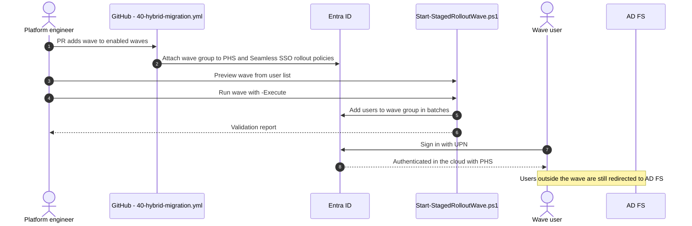

# Cutover runbooks

These runbooks move users, applications and finally the domain from AD FS to cloud authentication. Each runbook is a change with an owner, a window, entry criteria and a rollback.

## Staged rollout mechanics


Staged rollout has limits documented by Microsoft, including the number of objects that can be added to a feature at first population and the requirement to use cloud-only or synced security groups without nesting. The wave script batches membership to respect them. Check the current limits before each wave.


## Runbook 1 - Prepare cloud authentication



### Deploy Cloud Sync with password hash sync

Install provisioning agents on at least three servers per forest, configure the Cloud Sync job with password hash sync, and confirm with `Test-HybridSyncHealth.ps1` that every in-scope user has a synchronised hash.



### Prepare single sign-on

Configure Windows Hello for Business cloud Kerberos trust so Entra-joined devices can reach on-premises resources. Enable Seamless SSO only for domain-joined devices that remain during the transition.



### Apply the stack with no waves

Run `40-hybrid-migration.yml` for the target environment with no waves enabled. This creates the wave groups and the feature rollout policies without moving anyone.



## Runbook 2 - Move a wave



### Entry criteria

Previous wave stable for at least 7 days, help desk ticket volume back to baseline, no open sev-1 or sev-2 incident related to sign-in.



### Enable the wave

Open a pull request that appends the wave (`pilot`, then `wave1`, `wave2`, `all`) to the enabled waves list in the environment's tfvars. Merge after review; the workflow applies it.



### Populate the wave group

Run `Start-StagedRolloutWave.ps1` with the wave name and the user list. It previews by default; rerun with `-Execute` to apply. Keep the validation report with the change record.



### Verify

Sign-in logs for wave users show **Authentication requirement** satisfied by Entra ID with no redirect to AD FS. Check the sign-in logs filtered by the wave group and confirm no spike in failures.



## Runbook 3 - Migrate an application



### Define the enterprise application

Add the application to the migrated applications input of `40-hybrid-migration` with its identifiers, reply URLs, claims and assigned groups. The stack creates the enterprise application and its signing certificate.



### Test with a pilot group

Assign only the pilot group, configure the application's SAML or OIDC settings to point to Entra ID in a test instance, and validate claims.



### Switch production

Repoint the production application to Entra ID during its change window, then disable the AD FS relying party. Keep it for the rollback window, then delete it.



## Runbook 4 - Convert the domain to managed


Converting a domain from federated to managed is tenant wide and affects every user of that domain at once. Perform it only after the `all` wave has been stable and every relying party has been migrated or retired.




### Final prechecks

Run `Test-HybridSyncHealth.ps1`. Sign in with a cloud-only administrator account that is not on the domain being converted, so access survives if federation breaks.



### Convert

Run `Convert-DomainToManaged.ps1 -DomainName contoso.com` to execute the prechecks in preview mode, review, then rerun with `-Execute -BackupPath <folder>`. The script exports the current federation configuration to the backup folder before any change; store that file with the change record, because it is required for rollback.



### Disable staged rollout

Open a pull request that sets staged rollout off for the environment. After the domain is managed, staged rollout no longer has an effect.



### Monitor the rollback window

Keep AD FS running but unused for 30 days. Monitor AD FS server logs for residual traffic, which identifies anything missed.



### Decommission AD FS

Remove the Web Application Proxy servers from publishing, then remove the AD FS farm, its service account and its certificates. Remove the AD FS-related analytics exceptions from Sentinel.



## References

* [Migrate from federation to cloud authentication](https://learn.microsoft.com/en-us/entra/identity/hybrid/connect/migrate-from-federation-to-cloud-authentication)
* [Cloud authentication with staged rollout](https://learn.microsoft.com/en-us/entra/identity/hybrid/connect/how-to-connect-staged-rollout)
* [Manage federation with Microsoft Entra ID](https://learn.microsoft.com/en-us/entra/identity/hybrid/connect/how-to-connect-fed-management)
* [Migrate apps from AD FS stages](https://learn.microsoft.com/en-us/entra/identity/enterprise-apps/migrate-adfs-apps-stages)
* [Seamless single sign-on](https://learn.microsoft.com/en-us/entra/identity/hybrid/connect/how-to-connect-sso)
* [Windows Hello for Business cloud Kerberos trust](https://learn.microsoft.com/en-us/windows/security/identity-protection/hello-for-business/deploy/hybrid-cloud-kerberos-trust)
