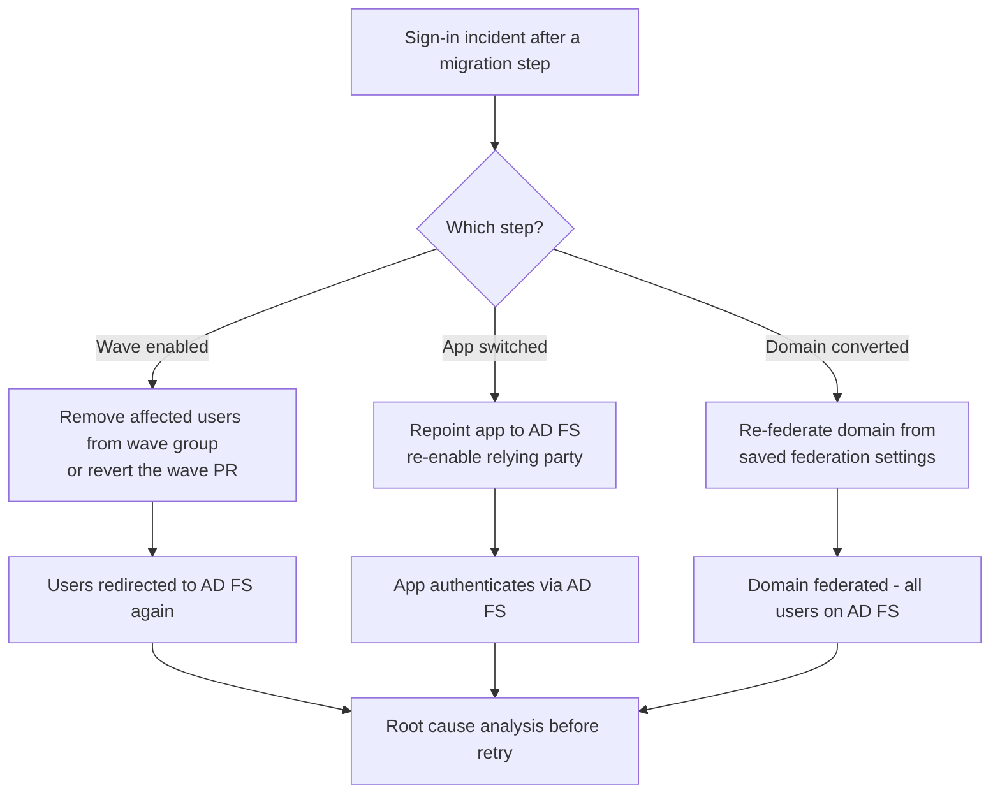

# Migration rollback

Every migration step has a defined way back. Rollback is triggered by the change owner when the exit criteria of a step are not met, and is performed with `Invoke-MigrationRollback.ps1` and, where needed, a revert pull request.

## Rollback decision

## Rollback by step

| Step | Rollback action | Tool | Time to effect | Prerequisite |
|---|---|---|---|---|
| Wave populated | Remove users from the wave group | `Invoke-MigrationRollback.ps1 -Action RemoveWaveUsers` | Minutes, next sign-in | None |
| Wave enabled | Revert the pull request that enabled the wave; for an emergency, disable the rollout policies first and mirror it in Terraform | Git revert and `40-hybrid-migration.yml`, or `Invoke-MigrationRollback.ps1 -Action DisableStagedRollout` | Minutes to one workflow run | Mirror any script change in tfvars or the next apply re-enables the policies |
| Application switched | Repoint application to AD FS, re-enable relying party | Application admin, AD FS | Per application | Relying party not yet deleted |
| Domain converted | Restore the federation configuration from the backup written by `Convert-DomainToManaged.ps1` | `Invoke-MigrationRollback.ps1 -Action RestoreFederation` | Up to an hour for token refresh | AD FS farm and token-signing certificate unchanged, backup file available |
| AD FS decommissioned | Not supported; rebuild | – | Days | – |


Once AD FS is decommissioned, rollback to federation means rebuilding a farm. That is why AD FS stays running for 30 days after domain conversion, and why decommission is a separate change with its own approval.


## Procedure - roll back a wave



### Declare rollback

Change owner records the decision and the reason in the change record.



### Remove users

Run `Invoke-MigrationRollback.ps1 -Action RemoveWaveUsers -Wave <wave> -Environment <env>` to preview, optionally with `-UserListPath` for a subset, then rerun with `-Execute`. Affected users are redirected to AD FS at their next sign-in.



### Revert configuration if needed

If the problem is the rollout policy itself, revert the pull request that enabled the wave and let `40-hybrid-migration.yml` apply it.



### Verify

Sign-in logs show the affected users authenticating through federation again.



## References

* [Migrate from federation to cloud authentication](https://learn.microsoft.com/en-us/entra/identity/hybrid/connect/migrate-from-federation-to-cloud-authentication)
* [Cloud authentication with staged rollout](https://learn.microsoft.com/en-us/entra/identity/hybrid/connect/how-to-connect-staged-rollout)
* [Manage federation with Microsoft Entra ID](https://learn.microsoft.com/en-us/entra/identity/hybrid/connect/how-to-connect-fed-management)
