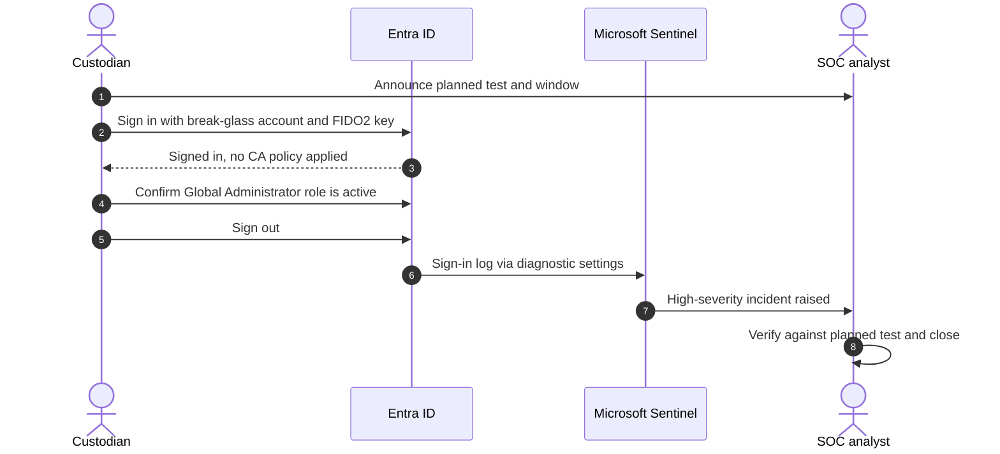

# Break-glass accounts

Two emergency access accounts restore administrative access when normal administrators cannot sign in: a Conditional Access misconfiguration, an MFA service outage, or the loss of every privileged admin. Microsoft recommends at least two such accounts, cloud-only, excluded from Conditional Access, and protected with phishing-resistant credentials.

## Account design

| Property | Value |
|---|---|
| Count | 2 |
| Type | Cloud-only, on the tenant's `onmicrosoft.com` domain, not synced, not federated |
| Role | Global Administrator, permanently active (not PIM) |
| Authentication | FIDO2 security keys as the primary method, two keys per account; a random 64-character password from the sensitive `emergency_access_initial_passwords` output, split between two custodians, as fallback |
| Conditional Access | Excluded from every policy through `zt-<env>-ca-exclude-emergency-access`, a role-assignable group so only Privileged Role Administrators can change its membership |
| Administrative unit | `zt-<env>-tier0-accounts` |
| Monitoring | Any sign-in raises the **Break-glass account sign-in** Sentinel incident |
| Custodians | Two named people, keys stored in separate physical safes |


Never assign a break-glass account to a person for daily use, never add it to a group that grants other access, and never store its credentials in a password manager that itself depends on Entra ID sign-in.


## Emergency use



### Declare the emergency

The incident commander declares a tenant access emergency and records the time and reason.



### Retrieve a key

A custodian retrieves one FIDO2 key from the safe, witnessed by a second person.



### Sign in and fix the minimum

Sign in from a known clean device. Make the smallest change that restores normal admin access, for example set the offending Conditional Access policy to report-only. Do not make other changes.



### Bring Git back in line

Open a pull request that reflects the emergency change, or reverts the change that caused the lock-out, so that the next pipeline run does not undo the fix.



### Close out

Sign out, return the key, record the actions in the incident, and review the Sentinel incident and audit log entries raised by the sign-in.



## Monthly test

| Check | Expected result | Evidence |
|---|---|---|
| Sign-in succeeds with FIDO2 key | Success | Sign-in log entry ID |
| Conditional Access result | **Not applied** for every policy | Sign-in log, Conditional Access tab |
| Global Administrator role active | Present | Screenshot of role assignment |
| Sentinel incident raised | Within detection interval | Incident number |
| Second account | Repeat for account 2 on alternate months, or both monthly | Same as above |

Record the evidence in the operations log. A failed test is a sev-2 incident.

## References

* [Manage emergency access accounts](https://learn.microsoft.com/en-us/entra/identity/role-based-access-control/security-emergency-access)
* [Plan a Conditional Access deployment](https://learn.microsoft.com/en-us/entra/identity/conditional-access/plan-conditional-access)
* [Authentication strengths](https://learn.microsoft.com/en-us/entra/identity/authentication/concept-authentication-strengths)
* [Enable passkeys (FIDO2)](https://learn.microsoft.com/en-us/entra/identity/authentication/how-to-enable-passkey-fido2)
