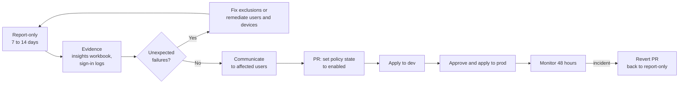

# Conditional Access promotion

Every Conditional Access policy is created in report-only mode (`enabledForReportingButNotEnforced`). This runbook moves a policy to enforced (`enabled`) based on evidence, one policy or one small group of related policies at a time.

## Promotion flow

## Recommended order

| Order | Policy | Reason |
|---|---|---|
| 1 | CA000 Block legacy authentication | Biggest risk reduction; little user impact once the remaining legacy clients are found |
| 2 | CA001 Block device code flow and authentication transfer | Low impact for most users |
| 3 | CA004 Security info registration | Protects MFA registration before broad MFA |
| 4 | CA005 MFA to register or join devices | Protects device registration |
| 5 | CA100 Phishing-resistant MFA for admins | Small population, high value |
| 6 | CA200 MFA for all internal users | Broad impact, after the registration campaign |
| 7 | CA400 MFA for guests | External users |
| 8 | CA002 Block unknown platforms | After platform inventory from report-only data |
| 9 | CA003, CA006, CA102, CA202, CA203 | Remaining session and location controls |
| 10 | CA300, CA301 Risk-based (P2) | After MFA, so users can self-remediate |
| 11 | CA101, CA201 Device and app protection | After `50-intune-foundation` compliance and app protection are assigned and devices report compliant |
| 12 | CA600 Token protection, CA500 workload identities | Last, after the device estate is stable |

## Procedure



### Gather evidence

Open the Conditional Access insights and reporting workbook, filter by the policy, and review the **Failure** and **User action required** results over at least 7 days. Drill into sign-in logs for the users and applications affected.



### Resolve the gaps

For each unexpected failure, decide whether to remediate (register MFA, enrol the device, update the client) or to exclude. Exclusions are groups managed in `10-entra-foundation`, reviewed through access reviews, never individual users added in the portal.



### Raise the pull request

Add the policy to `policy_state_overrides` in the environment's tfvars, for example `policy_state_overrides = { CA000 = "enabled" }`. Leave `ca_state` at `enabledForReportingButNotEnforced` so that new policies keep arriving in report-only. Attach the workbook evidence to the pull request description.



### Deploy

Merge. The `20-entra-conditional-access.yml` workflow applies to `dev`, then waits for `prod` approval.



### Monitor

Watch sign-in failures for the policy and help desk volume for 48 hours. If the impact is unacceptable, revert the pull request; the policy returns to report-only on the next apply.




If a promoted policy locks out administrators and the revert cannot be deployed because nobody can approve, use a [break-glass account](break-glass.md) to set the policy to report-only, then reconcile Git.


## Evidence checklist

* Insights workbook export for the policy covering at least 7 days.
* List of exclusions with justification and owner.
* User communication sent date.
* Pull request link and approver.

## References

* [Plan a Conditional Access deployment](https://learn.microsoft.com/en-us/entra/identity/conditional-access/plan-conditional-access)
* [Conditional Access report-only mode](https://learn.microsoft.com/en-us/entra/identity/conditional-access/concept-conditional-access-report-only)
* [Conditional Access insights and reporting](https://learn.microsoft.com/en-us/entra/identity/conditional-access/howto-conditional-access-insights-reporting)
* [Conditional Access policy templates](https://learn.microsoft.com/en-us/entra/identity/conditional-access/concept-conditional-access-policy-common)
