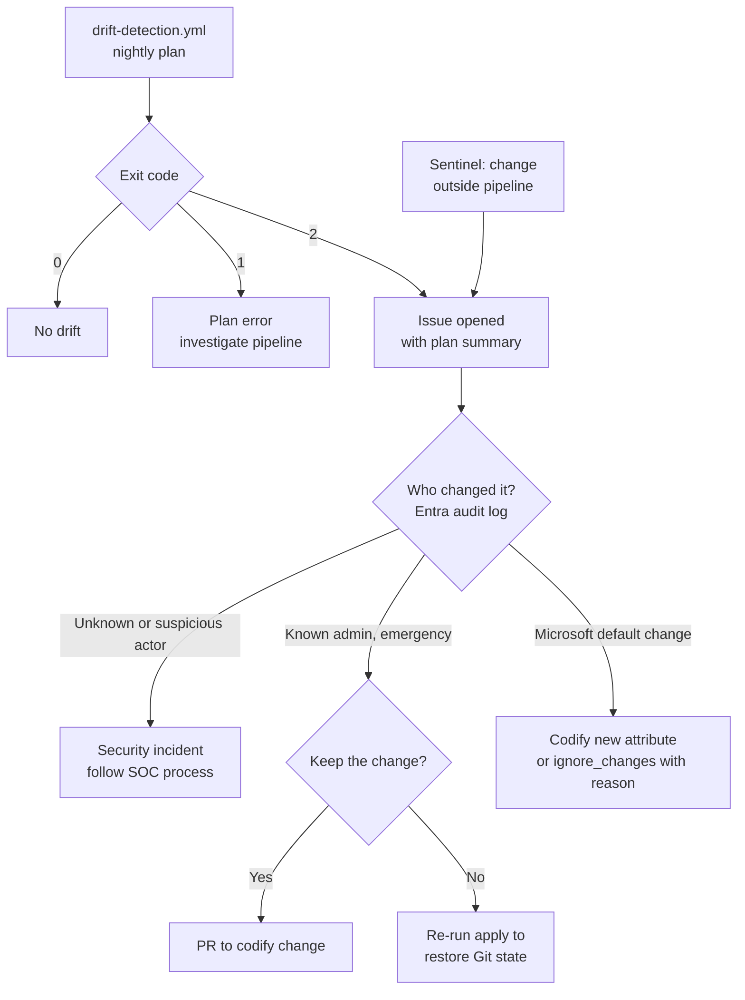

# Drift response

Drift is any difference between Git and the tenant. It comes from portal changes, changes by other automation, or Microsoft service changes to defaults. `drift-detection.yml` runs a nightly `terraform plan -detailed-exitcode` for every stack and environment and opens a GitHub issue when exit code 2 (changes present) is returned. Sentinel independently raises an incident for Conditional Access changes made outside the pipeline.

## Detection and triage

## Procedure



### Identify the change

Open the issue, read the plan summary, and find the corresponding entries in the Entra or Intune audit log: actor, time, target and modified properties.



### Classify

| Class | Example | Action |
|---|---|---|
| Malicious or unexplained | Unknown actor excludes a user from MFA policy | Security incident; restore Git state immediately |
| Emergency fix | Break-glass used to set a policy to report-only | Codify or revert via pull request within one business day |
| Unauthorised but benign | Admin renamed a group in the portal | Restore Git state; remind of the change process |
| Service-side | New attribute with a default appears in plan | Codify the attribute, or add a documented `ignore_changes` |



### Remediate through the pipeline

Either merge a pull request that codifies the change, or run the stack workflow with action `apply` for the environment to restore the declared state. Never fix drift by a second portal change.



### Close the issue

Link the pull request or workflow run, and the Sentinel incident if one was raised.




`ignore_changes` hides future drift on that attribute permanently. Use it only for attributes Microsoft manages, and leave a short comment explaining why.


## References

* [Microsoft Entra security operations guide](https://learn.microsoft.com/en-us/entra/architecture/security-operations-introduction)
* [Configure Microsoft Entra diagnostic settings](https://learn.microsoft.com/en-us/entra/identity/monitoring-health/howto-configure-diagnostic-settings)
* [Microsoft Sentinel overview](https://learn.microsoft.com/en-us/azure/sentinel/overview)
