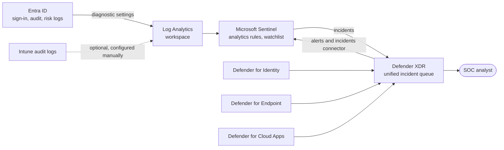

# Security operations

Stack: `terraform/stacks/70-security-operations` · Workflow: `70-security-operations.yml`

The security operations stack gives the SOC visibility of every identity and device decision the platform makes, and detections for the attacks most likely to target it. Architecture context is in [Security operations architecture](../architecture/security-operations-architecture.md).

## What the stack deploys

| Component | Design |
|---|---|
| Log Analytics workspace | Dedicated workspace for security data, retention 90 days in `dev` and 180 days in `prod`, workspace-level RBAC |
| Microsoft Sentinel | Onboarded on the workspace; operated from the Defender portal unified security operations experience |
| Entra ID diagnostic settings | Tenant diagnostic setting exporting audit, sign-in (interactive, non-interactive, service principal, managed identity), provisioning, risk and Microsoft Graph activity logs to the workspace. Intune diagnostic settings are not managed by Terraform and are optional |
| Data connectors | Each can be switched on or off through `data_connectors`: Microsoft Entra ID Protection, Microsoft Defender XDR, Office 365, Defender for Identity, Defender for Cloud Apps, Defender for Endpoint, Microsoft Threat Intelligence. Entra ID log data arrives through the diagnostic setting |
| Watchlist | `BreakGlassAccounts`, holding the emergency access account UPNs used by detections |
| Analytics rules | Scheduled rules for identity attacks, listed below, prefixed with the platform name prefix |

## SecOps data flow

## Analytics rules

| Rule | Detects | Severity | Response |
|---|---|---|---|
| Break-glass account sign-in | Any sign-in by an account in the `BreakGlassAccounts` watchlist | High | Confirm with custodian; if unplanned, treat as compromise |
| Conditional Access policy changed outside the pipeline | CA create, update or delete by an actor other than the CI service principal | High | Compare with Git, revert through the pipeline, see [Drift response](../operations/drift-response.md) |
| PIM role activation outside business hours | Role activation at unusual times | Medium | Confirm with the admin and approver |
| MFA fatigue: repeated denied or unanswered prompts | Repeated MFA denials or timeouts for one user | Medium | Reset sessions, require password change, check for credential leak |
| Successful legacy authentication sign-in | Legacy protocol sign-in succeeded | Medium | Find the client; the block policy may still be in report-only |
| Domain federation or authentication changed | Changes to domain federation settings or authentication type | High | Verify against the migration change record; attackers add federation for persistence |


Rules that detect changes outside the pipeline take the CI service principal's object ID as an allow-listed actor. A portal change therefore raises both a security incident and a drift signal.


## Defender integration notes



Install sensors on every domain controller, AD FS server and AD CS server while they exist. Sensors are deployed on-premises and are not managed by Terraform. Their alerts reach Sentinel through the Defender XDR connector.



Onboarding is delivered by the EDR policy in `50-intune-foundation`. Enable the Intune connection in the Defender portal so machine risk feeds compliance.



Connect Microsoft 365 and key SaaS apps in the Defender portal. Session control policies are enforced through Conditional Access app control, configured as a session control in `20-entra-conditional-access` where required.



## References

* [Microsoft Sentinel overview](https://learn.microsoft.com/en-us/azure/sentinel/overview)
* [Connect Microsoft Entra ID to Microsoft Sentinel](https://learn.microsoft.com/en-us/azure/sentinel/connect-azure-active-directory)
* [Microsoft Sentinel data connectors reference](https://learn.microsoft.com/en-us/azure/sentinel/data-connectors-reference)
* [Microsoft Defender XDR integration with Microsoft Sentinel](https://learn.microsoft.com/en-us/azure/sentinel/microsoft-365-defender-sentinel-integration)
* [Microsoft Defender XDR](https://learn.microsoft.com/en-us/defender-xdr/microsoft-365-defender)
* [Microsoft Defender for Identity](https://learn.microsoft.com/en-us/defender-for-identity/what-is)
* [Microsoft Entra security operations guide](https://learn.microsoft.com/en-us/entra/architecture/security-operations-introduction)
* [Configure Microsoft Entra diagnostic settings](https://learn.microsoft.com/en-us/entra/identity/monitoring-health/howto-configure-diagnostic-settings)
