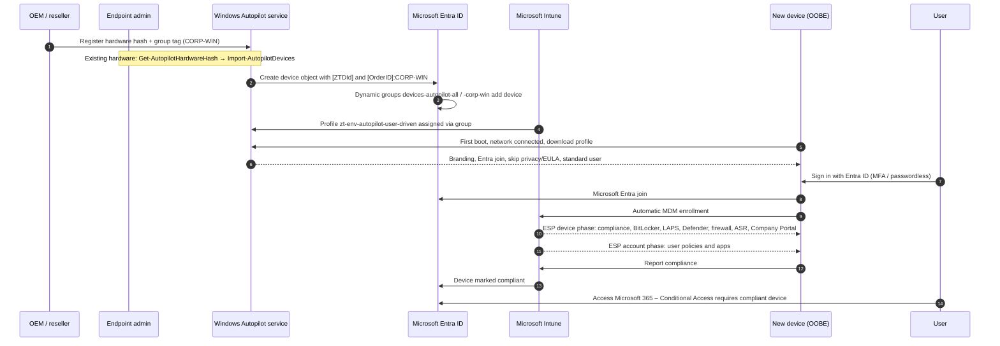

# scripts/intune

These PowerShell 7 scripts cover the parts of zero-touch provisioning that Terraform can't do: collecting hardware hashes from existing devices, importing them, and reporting compliance. Each script supports `-WhatIf`, has comment-based help (`Get-Help .\<script>.ps1 -Full`), and authenticates through `Connect-MgGraph`, so no secrets are stored.

| Script | Purpose | Graph permission |
|---|---|---|
| `Get-AutopilotHardwareHash.ps1` | Runs on the device (elevated, also from OOBE with Shift+F10). Reads `MDM_DevDetail_Ext01` and writes the import CSV; `-UseGetWindowsAutopilotInfo` delegates to the published script | none |
| `Import-AutopilotDevices.ps1` | Imports the CSV through `importedWindowsAutopilotDeviceIdentities` (v1.0) with a group tag, waits for processing, cleans up and syncs | `DeviceManagementServiceConfig.ReadWrite.All` |
| `Test-IntuneCompliance.ps1` | Read-only compliance and stale-device report; `-FailThresholdPercent` gates a pipeline stage | `DeviceManagementManagedDevices.Read.All` |

`templates/autopilot-devices.sample.csv` shows the expected columns.

## Zero-touch flow



The pre-provisioned path adds a technician phase: press the Windows key five times at OOBE, run the device phase, then reseal. The user then completes only the account phase. Self-deploying (KIOSK tag) has no user sign-in and needs TPM 2.0 attestation.

## Runbook: register existing devices

1. On each device, from an elevated prompt or OOBE Shift+F10:

   ```powershell
   .\Get-AutopilotHardwareHash.ps1 -OutputPath E:\autopilot\devices.csv -GroupTag CORP-WIN
   ```

2. From an admin workstation:

   ```powershell
   Connect-MgGraph -Scopes DeviceManagementServiceConfig.ReadWrite.All
   .\Import-AutopilotDevices.ps1 -CsvPath E:\autopilot\devices.csv -WhatIf
   .\Import-AutopilotDevices.ps1 -CsvPath E:\autopilot\devices.csv -Verbose
   ```

3. Confirm that the device appears in `zt-<env>-devices-autopilot-corp-win` and that the profile status is *Assigned*. Profile assignment can take up to 15 minutes after the dynamic group updates.
4. Reset the device (Settings > System > Recovery > Reset, or Autopilot Reset). It will provision on the next OOBE.

## Runbook: compliance gate

```powershell
.\Test-IntuneCompliance.ps1 -OperatingSystem Windows -StaleDays 14 -OutputPath .\windows-compliance.csv -FailThresholdPercent 5
```

## Troubleshooting

| Symptom | Check |
|---|---|
| `ZtdDeviceAssignedToOtherTenant` on import | The device is registered elsewhere; the OEM or previous owner must deregister it |
| Profile stays *Not assigned* | Group tag spelling (case-sensitive in the rule), dynamic group processing, or a duplicate profile assigned to `autopilot-all` |
| ESP timeout | Required app install failures. Collect diagnostics with Ctrl+Shift+D or `mdmdiagnosticstool.exe -area Autopilot -cab` |
| Self-deploying fails at TPM attestation | Firmware TPM 2.0 with EK certificate; update TPM firmware |
